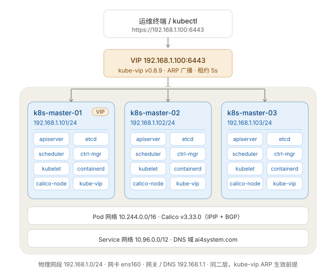

# Ubuntu 24.04 三节点 K8s 控制平面安装规划

> 目标：3 台 Ubuntu 24.04 服务器部署高可用（HA）Kubernetes 控制平面，
> stacked etcd 模式（etcd 与 apiserver 同机），kube-vip 提供统一 API 入口。
>
> **本文是方案说明。逐步可执行的命令手册见 `k8s-control-plane-install-runbook.md`（两者冲突以手册为准）。**

---

## 一、集群拓扑与节点规划



> 上图源文件：`k8s-topology.svg`（纯矢量，可缩放、可嵌入任何文档）。结构示意：

```
                    API VIP 192.168.1.100 (kube-vip ARP)
                       │ 漂移，任一 master 可持有
        ┌──────────────┼──────────────┐
   k8s-master-1   k8s-master-2   k8s-master-3
   192.168.1.101  192.168.1.102  192.168.1.103
   apiserver+etcd apiserver+etcd apiserver+etcd   ← stacked etcd，3 member
   Calico         Calico         Calico
```

| 主机名 | IP 地址 | 角色 | 配置建议 | 说明 |
|---|---|---|---|---|
| k8s-master-1 | 192.168.1.101 | control-plane | 4C / 8G / 60G SSD | etcd 对磁盘延迟敏感，必须 SSD |
| k8s-master-2 | 192.168.1.102 | control-plane | 4C / 8G / 60G SSD | 同上 |
| k8s-master-3 | 192.168.1.103 | control-plane | 4C / 8G / 60G SSD | 同上 |
| **kube-vip VIP** | **192.168.1.100** | — | — | 漂浮虚拟 IP，API Server 入口 |

> 最低配置 2C/4G 可跑通，但 etcd + 多组件同机，生产建议 4C/8G 起步。
> 三台机器间必须内网互通、时钟同步。

### 网段规划

| 项目 | 取值 | 备注 |
|---|---|---|
| Pod CIDR | 10.244.0.0/16 | ⚠️ 不能用 192.168.0.0/16（与物理网段 192.168.1.0/24 冲突） |
| Service CIDR | 10.96.0.0/12 | kubeadm 默认 |
| API VIP | 192.168.1.100 | kube-vip ARP 模式广播 |
| DNS 域 | ai4system.com | 自定义域名（默认 cluster.local） |

### 软件版本（示例，安装前请核对最新稳定版）

| 组件 | 版本 |
|---|---|
| OS | Ubuntu 24.04 LTS（内核 6.8+） |
| Kubernetes | v1.34.x（三台必须同版本） |
| containerd | 1.7.x（apt 官方仓库） |
| CNI | Calico v3.28（或 Cilium / Flannel） |
| kube-vip | v0.8.x（静态 Pod 方式） |

### HA 方案选型

| 方案 | 优点 | 缺点 | 结论 |
|---|---|---|---|
| **kube-vip（静态 Pod）** | 无需额外机器，随集群自举 | 仅二层网络（同网段 ARP） | ✅ 推荐 |
| HAProxy + Keepalived | 成熟稳定 | 需要额外 2 台机器或占用节点 | 机器充裕时可选 |
| 云负载均衡 | 免运维 | 仅公有云环境 | 云上首选 |

---

## 二、实施步骤（8 个阶段）

### 阶段 1：系统初始化（三台节点都执行）

```bash
# 1. 设置主机名（各节点分别执行）
sudo hostnamectl set-hostname k8s-master-1   # 102/103 相应修改

# 2. 写 hosts 解析（三台一致）
sudo tee /etc/hosts <<EOF
127.0.0.1 localhost
192.168.1.100 k8s-vip
192.168.1.101 k8s-master-1
192.168.1.102 k8s-master-2
192.168.1.103 k8s-master-3
EOF

# 3. 关闭 swap（kubeadm 硬性要求）
sudo swapoff -a
sudo sed -ri 's@^(/swap\S*\s+none\s+swap.*)@#\1@' /etc/fstab

# 4. 时间同步（Ubuntu 24.04 默认 systemd-timesyncd）
sudo timedatectl set-ntp true
timedatectl status   # 确认三台时间一致

# 5. 加载内核模块
cat <<EOF | sudo tee /etc/modules-load.d/k8s.conf
overlay
br_netfilter
EOF
sudo modprobe overlay && sudo modprobe br_netfilter

# 6. 内核参数
cat <<EOF | sudo tee /etc/sysctl.d/k8s.conf
net.bridge.bridge-nf-call-iptables  = 1
net.bridge.bridge-nf-call-ip6tables = 1
net.ipv4.ip_forward                 = 1
EOF
sudo sysctl --system
```

### 阶段 2：安装 containerd（三台节点）

```bash
sudo apt-get update
sudo apt-get install -y containerd

# 生成默认配置并改用 systemd cgroup 驱动（关键！与 kubelet 必须一致）
sudo mkdir -p /etc/containerd
containerd config default | sudo tee /etc/containerd/config.toml
sudo sed -i 's/SystemdCgroup = false/SystemdCgroup = true/' /etc/containerd/config.toml

# 国内环境建议替换 pause 镜像地址
sudo sed -i 's#registry.k8s.io/pause:3.8#registry.cn-hangzhou.aliyuncs.com/google_containers/pause:3.9#' /etc/containerd/config.toml

sudo systemctl restart containerd && sudo systemctl enable containerd
```

> 验证：`crictl info | grep -i systemdCgroup` 应返回 true。

### 阶段 3：安装 kubeadm / kubelet / kubectl（三台节点）

```bash
# 添加阿里云 apt 源（国内推荐；海外用 pkgs.k8s.io）
sudo apt-get install -y apt-transport-https ca-certificates curl gpg
curl -fsSL https://mirrors.aliyun.com/kubernetes-new/core/stable/v1.34/deb/Release.key \
  | sudo gpg --dearmor -o /etc/apt/keyrings/kubernetes-apt-keyring.gpg

echo "deb [signed-by=/etc/apt/keyrings/kubernetes-apt-keyring.gpg] https://mirrors.aliyun.com/kubernetes-new/core/stable/v1.34/deb/ /" \
  | sudo tee /etc/apt/sources.list.d/kubernetes.list

sudo apt-get update
sudo apt-get install -y kubelet kubeadm kubectl
sudo apt-mark hold kubelet kubeadm kubectl   # 防止意外升级
```

### 阶段 4：部署 kube-vip（仅 master-1，先手动运行）

```bash
export KVVERSION=v0.8.0
export VIP=192.168.1.100
export INTERFACE=eth0            # 按实际网卡名修改

# 设置 alias 拉取 kube-vip 工具镜像
alias kube-vip="docker run --rm --network host \
  -e VIP=$VIP -e INTERFACE=$INTERFACE ghcr.io/kube-vip/kube-vip:$KVVERSION"

# 生成本地清单目录 /etc/kubernetes/manifests（init 会用到）
mkdir -p /etc/kubernetes/manifests
kube-vip manifest pod \
  --interface $INTERFACE --address $VIP \
  --inRange --arp --leaderElection --controlplane \
  | sudo tee /etc/kubernetes/manifests/kube-vip.yaml
```

> 无 docker 的机器可直接 `curl -sL kube-vip.io/kvboot | sh -` 获取二进制执行 `kube-vip manifest pod`。

### 阶段 5：kubeadm init 初始化第一个控制平面（仅 master-1）

```bash
cat <<EOF | sudo tee kubeadm-config.yaml
apiVersion: kubeadm.k8s.io/v1beta4
kind: ClusterConfiguration
kubernetesVersion: v1.34.0
controlPlaneEndpoint: "192.168.1.100:6443"   # VIP，证书 SAN 会自动包含
imageRepository: registry.cn-hangzhou.aliyuncs.com/google_containers  # 国内
networking:
  podSubnet: "10.244.0.0/16"                  # 与 CNI 匹配，避开物理网段
  serviceSubnet: "10.96.0.0/12"
  dnsDomain: "ai4system.com"                  # 自定义集群 DNS 域
etcd:
  local:
    dataDir: /var/lib/etcd
---
apiVersion: kubelet.config.k8s.io/v1beta1
kind: KubeletConfiguration
cgroupDriver: systemd
EOF

sudo kubeadm init --config kubeadm-config.yaml \
  --upload-certs --certificate-key $(openssl rand -hex 32 | tee /tmp/cert-key.txt)
```

初始化成功后：

```bash
mkdir -p $HOME/.kube
sudo cp -i /etc/kubernetes/admin.conf $HOME/.kube/config
sudo chown $(id -u):$(id -g) $HOME/.kube/config
# 记录输出中的两条 join 命令（control-plane join 和 worker join）以及证书 key
```

### 阶段 6：加入 master-2 / master-3

```bash
# 在 master-2 / master-3 上执行 init 输出的 control-plane join 命令，形如：
sudo kubeadm join 192.168.1.100:6443 --token <token> \
  --discovery-token-ca-cert-hash sha256:<hash> \
  --control-plane --certificate-key <init 时生成的 key>

# 同样配置 kubeconfig
mkdir -p $HOME/.kube
sudo cp -i /etc/kubernetes/admin.conf $HOME/.kube/config
sudo chown $(id -u):$(id -g) $HOME/.kube/config
```

> token 24 小时过期：过期为 `kubeadm token create --print-join-command` 重新生成；
> 证书 key 过期为 `kubeadm init phase upload-certs --upload-certs` 重新上传。

### 阶段 7：安装 CNI 网络（任一 master 上）

```bash
# Calico：podSubnet 为 10.244.0.0/16，需修改清单中的 CALICO_IPV4POOL_CIDR
curl -o calico.yaml https://raw.githubusercontent.com/projectcalico/calico/v3.28.0/manifests/calico.yaml
sed -i 's#192.168.0.0/16#10.244.0.0/16#' calico.yaml
kubectl apply -f calico.yaml

# 国内网络不通时可改用：
# wget 下载后手动 kubectl apply -f calico.yaml
```

### 阶段 8：验证集群

```bash
kubectl get nodes -o wide        # 三节点 READY，控制面不用 taint 的话即可调度（默认带污点）
kubectl -n kube-system get pods  # etcd/apiserver/kube-vip/calico 全部 Running

# 检查 etcd 集群健康
sudo crictl ps | grep etcd
sudo ETCDCTL_API=3 etcdctl \
  --endpoints=https://127.0.0.1:2379 \
  --cacert=/etc/kubernetes/pki/etcd/ca.crt \
  --cert=/etc/kubernetes/pki/etcd/server.crt \
  --key=/etc/kubernetes/pki/etcd/server.key \
  member list -w table     # 三个 member，应有 leader

# 验证 VIP 漂移：任一 master 关机后，VIP 应自动漂到其余节点，kubectl 仍可用
```

---

## 三、防火墙端口清单（本环境为测试环境，ufw 直接关闭，本节仅备查）

> 测试环境做法：三台执行 `systemctl disable --now ufw && ufw disable`，确认 `ufw status` 为 inactive。
> 下表仅在未来转生产、需要重新启用防火墙时参考。

| 端口 | 协议 | 用途 | 开放范围 |
|---|---|---|---|
| 6443 | TCP | kube-apiserver | 全部节点 + VIP |
| 2379-2380 | TCP | etcd 客户端 / 节点间 | 仅三台 master |
| 10250 | TCP | kubelet API | 集群内 |
| 10259 | TCP | kube-scheduler | 仅本机/集群内 |
| 10257 | TCP | kube-controller-manager | 仅本机/集群内 |
| 8472/UDP | UDP | Calico VXLAN（默认 IPIP 则不占） | 全部节点 |
| 179 | TCP | Calico BGP | 全部节点 |

测试环境可临时 `sudo ufw disable`，生产按上表放行。

---

## 四、常见坑与对策

| 现象 | 原因 | 对策 |
|---|---|---|
| init 报 swap 错误 | 未关 swap | `swapoff -a` + 注释 fstab |
| join 报 cgroup 驱动不一致 | containerd 未设 SystemdCgroup=true | 阶段 2 的 sed 必须执行 |
| 镜像拉取超时 | registry.k8s.io 不可达 | 用阿里云 imageRepository / 代理 |
| 卡在 preflight "etcd port 2380" | 防火墙未放行 | 放行 2379-2380 |
| VIP 不通 | kube-vip 未用 ARP 模式 / 网卡名不对 | 确认 INTERFACE 与 `ip a` 一致 |
| 节点 NotReady | CNI 未装或 podSubnet 不匹配 | 核对 Calico CIDR |
| etcd 频繁超时 | 磁盘延迟高 | 换 SSD，`etcdctl check perf` |

---

## 五、后续事项（初始化完成后）

1. **备份**：定期 etcd 快照 —— `kubeadm init` 后用 etcdctl `snapshot save`，建议 cron 每日一次。
2. **扩容 worker**：用 init 输出的普通 join 命令加入 worker 节点。
3. **升级策略**：小版本升级用 `kubeadm upgrade`，先 master 后 worker，一次只升一个节点。
4. **可观测性**：部署 metrics-server，后续可加 Prometheus + Grafana。
5. **安全**：默认 admin.conf 是集群超级管理员，生产建议接入 RBAC + 证书轮换。

---

*规划中的 IP / 网段 / 版本可按实际环境调整；三台 master 的组件版本、cgroup 驱动、时间同步务必完全一致。*
