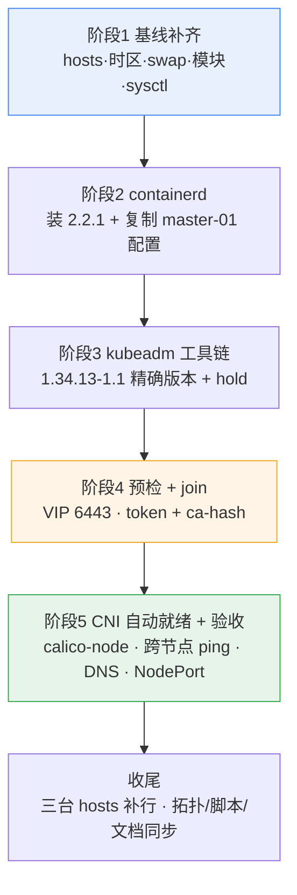

# 新增 Worker 节点实施计划 v2（k8s-worker-01 / 192.168.1.104）

> 编写时间：2026-10-31 16:50 CST
> **状态：已执行完成（2026-10-31 16:49 → 17:00），验收全绿，执行记录见第 8 节**
> 适用集群：3 × control-plane（VIP 192.168.1.100），K8s v1.34.13 / containerd 2.2.1 / Calico v3.33.0
> **v2 变更**：目标节点确定为 `k8s-worker-01 / 192.168.1.104`（v1 曾规划 .105）；机器已存在且已完成部分基线，计划据此收敛为 5 个阶段、约 25 分钟。

---

## 0. 一句话结论

这台机器**底子很干净**：主机名、静态 IP、cloud-init 禁用、ufw 关闭、machine-id 唯一都已就绪；
**只差 7 项基线 + containerd + kubeadm 三件套，然后 join**。全程只读风险低，回滚两条命令。

---

## 1. 节点实测现状（2026-10-31 16:47 登录采样）

| 项 | 实测值 | 评价 |
|---|---|---|
| 主机名 | **k8s-worker-01** | ✅ 已设 |
| IP / 网卡 | **192.168.1.104/24 @ ens160**，gw 192.168.1.1 | ✅ 静态（netplan `50-cloud-init.yaml`） |
| OS / 内核 | Ubuntu 24.04.3 LTS / 6.8.0-147-generic | ✅ 与 master 完全一致 |
| 规格 | **8 vCPU / 31G 内存 / 96G 磁盘（用 12%，剩 81G）** | ✅ 比 master（4C/15G/57G）更宽裕 |
| machine-id | `526a5787…6132c`（master-02 为 `d0c723ee…82df3`） | ✅ 唯一，不是克隆重复 |
| cloud-init | **disabled**（`/etc/cloud/cloud-init.disabled` 存在） | ✅ 不会覆盖网络配置 |
| ufw | **inactive** | ✅ 与现网一致 |
| containerd / kubeadm / kubelet | **均未安装**（containerd 候选版本 `2.2.1-0ubuntu1~24.04.4`，与现网精确匹配） | ⚠️ 待装 |
| 到 VIP:6443 | `200` | ✅ 网络路径通 |
| 到阿里云 K8s 源 | `200` | ✅ 装机可直连 |
| apt 源 | `cn.archive.ubuntu.com`（与 master 相同） | ✅ 无需换源 |

---

## 2. 基线差异清单（开工前 7 项待办）

| # | 项目 | 当前 | 目标 | 影响 |
|---|---|---|---|---|
| 1 | `/etc/hosts` | 只有自身 + IPv6 默认项 | 补 `k8s-vip` 与三台 master | 便利性；不影响 join |
| 2 | 时区 | **UTC** | Asia/Shanghai | 日志时间与集群对不上，排错易误判 |
| 3 | swap | **开着 8G（/swap.img）** | 关闭 + fstab 注释 | kubelet 会拒绝启动（`failed to run Kubelet: running with swap on is not supported`） |
| 4 | 内核模块 | **overlay / br_netfilter / ipip 均未加载** | modules-load.d 持久化 | 缺 ipip → Calico IPIP 隧道起不来，跨节点 Pod 不通 |
| 5 | sysctl | `ip_forward=0` | `ip_forward=1` + `bridge-nf-call-iptables=1` | 无转发 → Pod 出不了节点；Service 转发异常 |
| 6 | containerd | 未安装 | 2.2.1 + 复制 master 配置 | 核心 |
| 7 | kubeadm/kubelet/kubectl | 未安装 | **1.34.13-1.1**（精确） | 版本漂移会被 join 拒绝 |

> 不需要再做的（v1 里为"克隆机"准备的动作，本机全部可跳过）：换 MAC、重置 machine-id、禁用 cloud-init、重配网卡。

---

## 3. 五个必须对齐的集群特化参数

默认 kubeadm 教程拿来直接用会踩坑，以下均为本集群实测值：

| 参数 | 本集群值 | 默认值（会错） |
|---|---|---|
| 集群 DNS 域 | **ai4system.com** | cluster.local |
| Pod CIDR / Service CIDR | 10.244.0.0/16 / 10.96.0.0/12 | — |
| join 地址 | **192.168.1.100:6443（VIP）** | 单 master IP |
| sandbox 镜像 | `registry.aliyuncs.com/google_containers/pause:3.10` | registry.k8s.io（**国内不通**） |
| containerd 配置格式 | **version 3**（2.x 新键名 `pinned_images.sandbox`） | 1.7 的 `sandbox_image` 已失效 |
| Calico | v3.33.0，IPIP **Always**，manifest 装在 kube-system | — |
| IP 自动探测 | `can-reach=192.168.1.1` | — |

**结论：containerd 的 `config.toml` + `certs.d/` 直接从 master-01 复制，不要手写。**

---

## 4. 执行计划（5 阶段，约 25 分钟）



### 阶段 1：基线补齐（5 分钟）

```bash
# ① hosts（worker 侧）
sudo tee -a /etc/hosts > /dev/null <<'EOF'
192.168.1.100  k8s-vip
192.168.1.101  k8s-master-01
192.168.1.102  k8s-master-02
192.168.1.103  k8s-master-03
192.168.1.104  k8s-worker-01
EOF

# ② 时区（当前 UTC）
sudo timedatectl set-timezone Asia/Shanghai

# ③ 关 swap（当前 8G 开着，不关 kubelet 直接起不来）
sudo swapoff -a
sudo sed -i '/\sswap\s/s/^/#/' /etc/fstab
swapon --show          # 期望空输出

# ④ 内核模块
sudo tee /etc/modules-load.d/k8s.conf > /dev/null <<'EOF'
overlay
br_netfilter
ipip
EOF
sudo modprobe overlay && sudo modprobe br_netfilter && sudo modprobe ipip

# ⑤ sysctl
sudo tee /etc/sysctl.d/99-k8s.conf > /dev/null <<'EOF'
net.bridge.bridge-nf-call-iptables  = 1
net.bridge.bridge-nf-call-ip6tables = 1
net.ipv4.ip_forward                 = 1
EOF
sudo sysctl --system

# ⑥ 基础工具
sudo apt-get update && sudo apt-get install -y curl gnupg ca-certificates apt-transport-https
# ufw 已 inactive，无需处理
```

### 阶段 2：containerd（8 分钟，最关键）

```bash
# ① 装同版本（Ubuntu 24.04 仓库候选即 2.2.1-0ubuntu1~24.04.4，与现网一致）
sudo apt-get install -y containerd

# ② 从 master-01 复制配置（本机中转，避免节点间免密）
#    —— 由运维机执行：master-01 → 本地 → worker
mkdir -p /tmp/ctr-cfg && cd /tmp/ctr-cfg
scp lumz@192.168.1.101:/etc/containerd/config.toml .
scp -r lumz@192.168.1.101:/etc/containerd/certs.d .
scp config.toml lumz@192.168.1.104:/tmp/config.toml
scp -r certs.d lumz@192.168.1.104:/tmp/certs.d

# ② 在 worker 上落位
sudo cp /tmp/config.toml /etc/containerd/config.toml
sudo mkdir -p /etc/containerd/certs.d && sudo cp -r /tmp/certs.d/* /etc/containerd/certs.d/
sudo chown -R root:root /etc/containerd

# ③ 启动并验证（必须走 CRI 路径，不能用 ctr）
sudo systemctl enable --now containerd
sudo systemctl restart containerd
sudo crictl -r unix:///run/containerd/containerd.sock version
sudo crictl -r unix:///run/containerd/containerd.sock pull registry.aliyuncs.com/google_containers/pause:3.10
```

复制过来的配置含三处关键内容（务必核对）：
- `[plugins.'io.containerd.cri.v1.images'.pinned_images] sandbox = 'registry.aliyuncs.com/google_containers/pause:3.10'`
- `[plugins.'io.containerd.cri.v1.images'.registry] config_path = '/etc/containerd/certs.d'`
- `certs.d/{docker.io,ghcr.io,quay.io}/hosts.toml`（daocloud 加速）

### 阶段 3：kubeadm 工具链（5 分钟）

```bash
# ① 阿里云 v1.34 源（与现网同一地址）
sudo mkdir -p /etc/apt/keyrings
curl -fsSL https://mirrors.aliyun.com/kubernetes-new/core/stable/v1.34/deb/Release.key \
  | sudo gpg --dearmor -o /etc/apt/keyrings/kubernetes-apt-keyring.gpg

echo "deb [signed-by=/etc/apt/keyrings/kubernetes-apt-keyring.gpg] https://mirrors.aliyun.com/kubernetes-new/core/stable/v1.34/deb/ /" \
  | sudo tee /etc/apt/sources.list.d/kubernetes.list

sudo apt-get update

# ② 确认候选版本里有 1.34.13-1.1（没有就先 madison 查）
apt-cache madison kubeadm | head -5

# ③ 精确安装 + 锁定
sudo apt-get install -y kubeadm=1.34.13-1.1 kubelet=1.34.13-1.1 kubectl=1.34.13-1.1
sudo apt-mark hold kubeadm kubelet kubectl

# ④ 只 enable 不 start（join 时由 kubeadm 拉起）
sudo systemctl enable kubelet
kubeadm version -o short          # 期望 v1.34.13
```

### 阶段 4：预检 + join（3 分钟）

```bash
# ——— 预检（worker 上）———
curl -k https://192.168.1.100:6443/healthz        # 期望 ok
ls /etc/kubernetes 2>&1                            # 期望 No such file（无残留）
swapon --show                                      # 期望空
lsmod | grep ipip                                  # 期望有
systemctl is-active kubelet                        # 期望 inactive

# ——— master 上生成 join 命令 ———
kubeadm token create --print-join-command

# ——— worker 上执行（示例）———
sudo kubeadm join 192.168.1.100:6443 --token xxxxxx.xxxxxxxxxxxxxxxx \
  --discovery-token-ca-cert-hash sha256:xxxxxxxx...
```

三个注意点：
1. **不加 `--control-plane`、不加 `--certificate-key`**（那是控制面节点专用）
2. join 地址是 **VIP 192.168.1.100**（来自 `controlPlaneEndpoint`），不是某台 master IP
3. 不需要装 kube-vip —— 装到 worker 会抢 VIP，造成控制面脑裂

### 阶段 5：CNI 自动就绪 + 验收（8 分钟）

join 后**无需任何手工操作**：`calico-node` 与 `kube-proxy` 是 DaemonSet，会自动调度到新节点。

```bash
# ① 节点与 DaemonSet
kubectl get nodes -o wide                                   # 期望 4 台 Ready
kubectl -n kube-system get pods -o wide | grep k8s-worker-01 # calico-node / kube-proxy 各 1

# ② Pod 网段块（blockSize=26 → 每节点 64 IP）
kubectl get blockaffinities.crd.projectcalico.org

# ③ 打角色标签
kubectl label node k8s-worker-01 node-role.kubernetes.io/worker=""

# ④ 跨节点连通性（真实走 IPIP 隧道）
kubectl run nettest --image=nicolaka/netshoot --restart=Never --command -- sleep 1800
kubectl wait --for=condition=Ready pod/nettest --timeout=120s
kubectl get pod nettest -o wide                              # 确认落在 k8s-worker-01
DBIP=$(kubectl -n kuboard get pod -l app=kuboard-db -o jsonpath='{.items[0].status.podIP}')
kubectl exec nettest -- ping -c3 $DBIP                       # 期望 0% loss

# ⑤ 集群 DNS（域名是 ai4system.com）
kubectl exec nettest -- nslookup kubernetes.default.svc.ai4system.com

# ⑥ 外部入口不受影响
curl -s -o /dev/null -w '%{http_code}\n' http://192.168.1.100:30080   # kuboard
curl -s -o /dev/null -w '%{http_code}\n' http://192.168.1.100:30081   # headlamp

kubectl delete pod nettest
```

| 验收项 | 期望 |
|---|---|
| `kubectl get nodes` | 4 台 Ready，VERSION 均 **v1.34.13** |
| worker 上 DaemonSet | calico-node 1/1、kube-proxy 1/1 |
| blockaffinities | 新增一条 `10.244.x.0/26` 归属 k8s-worker-01 |
| 跨节点 ping | 0% packet loss |
| DNS | 解析到 10.96.0.1 |
| NodePort 30080/30081 | 200 |

### 收尾

```bash
# 三台 master 的 /etc/hosts 各补一行
echo "192.168.1.104  k8s-worker-01" | sudo tee -a /etc/hosts
```

需同步的工作区文件：`k8s-topology.svg`（补第 4 台）、安装手册 1.1 节点表、`scripts/host_inspect.sh` 与 `.workbuddy/reports/run_inspect.py` 的节点列表（现写死 .101/.102/.103）、`README.md` 文档地图、运维手册补「节点扩容」一节。

---

## 5. 回滚（2 分钟，对 etcd 零影响）

```bash
# worker 侧
sudo kubeadm reset -f
sudo rm -rf /etc/cni/net.d /var/lib/cni /var/lib/kubelet /etc/kubernetes
sudo systemctl restart containerd

# master 侧
kubectl delete node k8s-worker-01

# 若有残留网段块（一般自动回收）
kubectl get blockaffinities.crd.projectcalico.org | grep worker-01
```

> 加 worker 不碰 etcd、不影响 quorum —— 这是它比加控制面节点安全得多的原因。

---

## 6. 风险与红线

| 风险 | 后果 | 防控 |
|---|---|---|
| **swap 忘了关** | kubelet 直接起不来 | 阶段 1 已列，`swapon --show` 必须为空 |
| **缺 ipip 模块** | Calico 起不来 / 跨节点 Pod 不通 | 阶段 1 写入 modules-load.d |
| containerd 配置与 master 不一致 | 镜像拉不到、sandbox 启动失败 | **复制而非手写** |
| 版本漂移（装了 1.35） | join 被拒或 kubelet 异常 | 精确版本号 + `apt-mark hold` |
| 误装 kube-vip | 抢 VIP → 控制面脑裂 | 明确不装 |
| join 期间动控制面 | etcd 抖动，可能丢 quorum | 期间禁止 drain / 重启 / 升级 master |
| 多网卡导致 IP 探测错 | Calico 选错网卡 | 本机只有一块 ens160（IPv6 全球地址与 master 同样存在，Calico 只认 IPv4 + `can-reach`，无影响） |

---

## 7. 容量与后续

这台 worker **8C/31G/96G，比 master 更强**，能承载较重工作负载（后续 Doris/Spark 客户端类组件可优先放这里）。

| 优先级 | 事项 | 说明 |
|---|---|---|
| P1 | **存储解耦** | 装 local-path-provisioner，把 Kuboard 从"钉死 master-01 的 hostPath"迁走 —— 这是今天 master-01 失联导致面板挂掉的根因 |
| P1 | metrics-server | 目前 `kubectl top` 不可用，4 节点后才有意义 |
| P2 | 恢复 master 污点 | 完成存储解耦后，把业务收敛到 worker，master 专职控制面 |
| P2 | 第二台 worker | 单 worker 会成为业务单点；建议规划 k8s-worker-02（.105 空闲可预留） |
| P2 | 监控 | node-exporter + Prometheus，或至少把 worker 纳入巡检脚本 |

---

## 附：一页速查

```bash
# master 生成 join 命令
kubeadm token create --print-join-command

# worker 加入
sudo kubeadm join 192.168.1.100:6443 --token <t> --discovery-token-ca-cert-hash sha256:<h>

# 验证
kubectl get nodes -o wide
kubectl -n kube-system get pods -o wide | grep worker
kubectl get blockaffinities.crd.projectcalico.org

# 回滚
sudo kubeadm reset -f && kubectl delete node k8s-worker-01
```

---

## 8. 执行记录（2026-10-31 16:49 → 17:00，已完成）

### 8.1 结果

| 阶段 | 实际结果 | 耗时 |
|---|---|---|
| 阶段 1 基线 | hosts 5 条写入；时区 CST；swap 关闭（fstab 第 12 行注释）；ipip/br_netfilter/overlay 已加载；`ip_forward=1`、`bridge-nf-call-iptables=1` | ~1 min |
| 阶段 2 containerd | 装 2.2.1-0ubuntu1~24.04.4；config.toml 与 master-01 **md5 一致**（`99356ae6549221e1a624d73985d61dc4`，8020B）；certs.d 三个 registry 加速齐全 | ~4 min |
| 阶段 3 工具链 | kubeadm/kubelet/kubectl **1.34.13-1.1**（已 hold）+ cri-tools v1.34.0 | ~2 min |
| 阶段 4 join | `kubeadm join 192.168.1.100:6443` 成功，TLS Bootstrap 完成，kubelet 501ms 内 healthy | ~1 min |
| 阶段 5 CNI | worker 2m42s 转 **Ready**；calico-node / kube-proxy 各 1/1；blockaffinity `k8s-worker-01-10-244-36-192-26` | ~3 min |

### 8.2 验收实测

| 项 | 结果 |
|---|---|
| 节点 | **4 台 Ready**，ROLES：3×control-plane + **1×worker**，VERSION 全 v1.34.13，运行时全 containerd 2.2.1 |
| worker 可分配 | **8 CPU / 32763712Ki（31G）/ 110 pods** |
| Node Conditions | Ready=True、NetworkUnavailable=False（`CalicoIsUp`）、Memory/Disk/PID 压力均 False |
| 跨节点 Pod 通信 | worker(10.244.36.193) → master-01 上 kuboard-db(10.244.151.136)：**3/3 收包，0% loss，avg 0.37ms** |
| 集群 DNS | `kubernetes.default.svc.ai4system.com` → 10.96.0.1 解析正常 |
| Service / API | kuboard Service **200**；`https://192.168.1.100:6443/healthz` **200** |
| 全集群 Pod | 除 Completed 外**全部 Running** |
| 面板 | Kuboard `:30080` 200、Headlamp `:30081` 200（未受影响） |
| 镜像拉取 | aliyun pause:3.10 ✅ / quay calico/node:v3.33.0 ✅（验证三处加速生效） |

### 8.3 过程中遇到的问题

1. **`sudo -S` 密码提示与输出粘在同一行** —— `printf pw | sudo -S base64 ...` 时 `[sudo] password for lumz: ` 不带换行，base64 内容被拼到同一行，按行过滤 sudo 输出会把整段数据删掉（首次导出 config.toml 得到 0 字节）。
   **解法：改用 `sudo -S -p ''`**（关闭提示），或干脆 SFTP 上传脚本后 `sudo bash /tmp/x.sh`。
2. **`cri-tools` 不在 Ubuntu 源** —— 需在 K8s 阿里云源添加后安装（`v1.34.0`）。
3. **SFTP `mkdir` 不递归** —— 上传 `certs.d/docker.io/` 前需先 `mkdir -p` 父目录，否则 `FileNotFoundError`。
4. **Calico 无需任何操作**：join 后 calico-node 自动调度、自动申领 `/26` 网段块，IPIP 隧道即刻可用（前提是 ipip 模块已预加载）。

### 8.4 本次未做（保持现状）

- 三台 master **仍无污点**（业务 Pod 继续可调度到 master）；要恢复污点须先迁走 Kuboard 的 hostPath PV，见第 7 节 P1。
- 未装 metrics-server（`kubectl top` 仍不可用）。
- 未改 IPPool / kube-proxy 参数 / etcd 成员，未升级任何组件。

---

## 9. 第二台 worker 执行记录（k8s-worker-05 / 192.168.1.105，2026-10-31 17:14 → 17:24，已完成）

> 完全复用第 8 节流程，5 阶段耗时 **约 10 分钟**。除主机名/IP 外，无任何参数差异。
>
> **后续（2026-10-31 17:55）**：该节点已按 `k8s-remove-worker-node-plan.md` 移除并改名为 **`k8s-worker-02`** 重新加入（命名与 worker-01 的序号规则对齐），block 由 `10.244.55.192/26` 变更为 `10.244.118.64/26`。本节记录的是其以 `k8s-worker-05` 身份首次加入时的状态。

### 9.1 该机初始现状（与 worker-01 的差异）

| 项 | 初始值 | 与 worker-01 对比 |
|---|---|---|
| 主机名 | **k8s-worker-05** | 注意：按 IP 尾号命名，与 `k8s-worker-01` 的序号规则不一致（未改动，保留用户设置） |
| IP / 网卡 | 192.168.1.105/24 @ ens160（netplan 静态，gw .1） | 相同 |
| OS / 内核 | Ubuntu 24.04.3 / 6.8.0-147-generic | 完全相同 |
| 规格 | 8C / 31G / 96G（剩 81G） | 完全相同 |
| machine-id | `ee3d8ea8…` | 唯一 ✅ |
| cloud-init | **已 disabled**（marker file） | 相同 |
| containerd 候选 | 2.2.1-0ubuntu1~24.04.4 | 相同 |
| 待补基线 | hosts / 时区 UTC / **swap 8G 开着** / 模块全未加载 / ip_forward=0 / 无 k8s 组件 | 与 worker-01 初始状态完全一致 |

### 9.2 结果

| 阶段 | 结果 | 耗时 |
|---|---|---|
| 阶段 1 基线 | hosts 6 条（含 worker-05 自身）；时区 CST；swap 关闭（fstab 第 12 行注释）；overlay/br_netfilter/ipip 已加载；`ip_forward=1` | ~1 min |
| 阶段 2 containerd | 装 2.2.1；config.toml **md5 一致**（`99356ae6549221e1a624d73985d61dc4`，8020B）；certs.d 三加速齐全；CRI 通、pause:3.10 就绪 | ~4 min |
| 阶段 3 工具链 | kubeadm/kubelet/kubectl **1.34.13-1.1**（hold）+ cri-tools v1.34.0 | ~2 min |
| 阶段 4 join | `kubeadm join 192.168.1.100:6443` 成功，kubelet 501.7ms healthy | ~1 min |
| 阶段 5 CNI | worker 转 Ready（约 2m10s）；calico-node / kube-proxy 1/1；blockaffinity `k8s-worker-05-10-244-55-192-26` | ~3 min |

### 9.3 验收实测

| 项 | 结果 |
|---|---|
| 集群规模 | **5 台 Ready**（3 control-plane + 2 worker），全部 v1.34.13 / containerd 2.2.1 |
| worker-05 可分配 | **8 CPU / 32763704Ki（31G）/ 110 pods**，ROLES=`worker` |
| Node Conditions | Ready=True、NetworkUnavailable=False（`CalicoIsUp`）、三类压力均 False |
| 跨节点 Pod 通信 | worker-05 `10.244.55.193` → master-01 上 kuboard-db `10.244.151.136`：**3/3 收包，0% loss，avg 0.363ms** |
| DNS | `kubernetes.default.svc.ai4system.com` → 10.96.0.1 正常 |
| Service / API | kuboard Service **200**；`https://192.168.1.100:6443/healthz` **200** |
| 全集群 Pod | 除 Completed 外**全部 Running** |
| 面板 | Kuboard `:30080` 200、Headlamp `:30081` 200，未受影响 |
| 补 hosts | 3 台 master + worker-01 均已加入 `192.168.1.105 k8s-worker-05` |

### 9.4 与第一台的差异（可复用的经验）

- **无新增踩坑**：第 8.3 节的三条（`sudo -S -p ''`、cri-tools 来源、SFTP 不递归 mkdir）全部沿用即可。
- config.toml 直接从**本地存档**（`.workbuddy/reports/wk/containerd/`）取用，不必每次回 master-01 导一遍 —— 前提是 master 侧 containerd 配置未变（本次 md5 校验仍一致）。
- 第二台从开机到 Ready 可压到 **10 分钟**（第一台 13 分钟，差异主要在首次摸索）。

### 9.5 仍未做（与 worker-01 同期遗留）

- master 仍无污点、未装 metrics-server、Kuboard 仍钉在 master-01 hostPath。
- 现在有 2 台 8C/31G 的 worker，**存储解耦（local-path-provisioner）的收益进一步放大**，建议优先安排。
