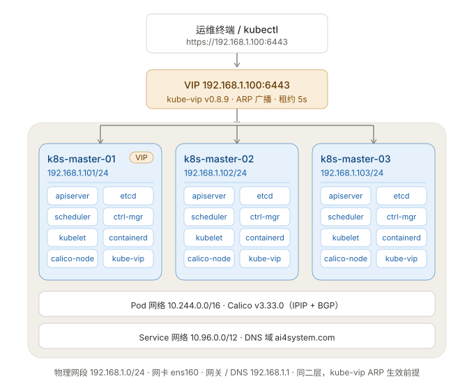

# K8s 控制平面安装实施手册（Ubuntu 24.04 × 3 台）

> 适用场景：3 台 Ubuntu 24.04 已装完系统、网络已通，从零部署高可用控制平面。
> 结构：stacked etcd（etcd 与 apiserver 同机）+ kube-vip 虚拟 IP。
> 全流程约 **1.5 ~ 2 小时**，建议预留 3 小时窗口（含排错余量）。
>
> 与 `k8s-3node-control-plane-plan.md` 的关系：那份是方案说明，**这份是可执行的手册**，冲突时以本手册为准。

---

## 一、固定参数（全程唯一来源，改这里即可）

### 集群拓扑



> 上图源文件：`k8s-topology.svg`（纯矢量，可缩放、可嵌入任何文档）。结构示意：

```
                    API VIP 192.168.1.100 (kube-vip ARP)
                       │ 漂移，任一 master 可持有
        ┌──────────────┼──────────────┐
   k8s-master-1   k8s-master-2   k8s-master-3
   192.168.1.101  192.168.1.102  192.168.1.103
   apiserver+etcd apiserver+etcd apiserver+etcd   ← stacked etcd，3 member
   Calico         Calico         Calico
```

| 变量 | 值 | 说明 |
|---|---|---|
| VIP | 192.168.1.100 | 未被占用的空闲 IP |
| NODE1 | 192.168.1.101 | k8s-master-1，init 节点 |
| NODE2 | 192.168.1.102 | k8s-master-2 |
| NODE3 | 192.168.1.103 | k8s-master-3 |
| IFACE | eth0 | ⚠️ 必须先用 `ip -br a` 确认实际网卡名 |
| K8S_VERSION | v1.34 | 三台必须完全一致 |
| POD_CIDR | 10.244.0.0/16 | 避开物理网段 192.168.1.0/24 |
| SVC_CIDR | 10.96.0.0/12 | 默认 |
| DNS_DOMAIN | ai4system.com | 集群内部域名 |
| CONTAINERD_VER | apt 仓库版（1.7.x / 2.x） | 三台一致 |

**部署前必须确认的 3 件事：**
1. `192.168.1.100` 在现有网络中确实空闲（`ping 192.168.1.100` 无响应，且交换机/路由器未占用）
2. 三台机器在同一二层网络（kube-vip 用 ARP 模式，跨网段不生效）
3. 三台能互相 SSH 免密，且时间误差 < 1 秒

---

## 二、执行顺序总览

```
阶段1 系统基线 ─┐
阶段2 关防火墙  ├─ 三台节点全部执行（可并行）
阶段3 containerd┤
阶段4 安装工具 ─┘
        ↓
阶段5 kube-vip（仅 master-1）→ 阶段6 kubeadm init（仅 master-1）
        ↓
阶段7 join master-2 / master-3
        ↓
阶段8 安装 CNI → 阶段9 验证 → 阶段10 备份与基线固化
```

**关键时序约束**：阶段5、6 必须在 master-1 顺序执行；阶段7 必须在阶段6 成功后 **2 小时内**完成（证书 key 有效期 2 小时）。

---

## 阶段 0：开工前检查（三台，5 分钟）

```bash
# 系统与硬件确认
lsb_release -a          # 期望 Ubuntu 24.04.x LTS
uname -r                # 期望 6.8.x 或更高
nproc && free -h && df -h /var
ip -br a                # ⚠️ 记录网卡名，后续 IFACE 用这个

# 网络连通性（三台都要能 ping 通对方与网关）
ping -c2 192.168.1.101
ping -c2 192.168.1.102
ping -c2 192.168.1.103
ping -c2 192.168.1.100   # 期望不通（VIP 尚未启用）

# 时间同步状态，三台 Offset 应接近 0
timedatectl status

# 确认 VIP 未被占用
arping -c 3 -I $(ip -o -4 route show default | awk '{print $5}') 192.168.1.100
```

**通过标准**：三台互相 ping 通、VIP 不通、时间一致、网卡名已记录。
**不通过就先解决网络问题，不要往下走**——网络问题在 init 阶段会以各种诡异形式报错，排查成本高 10 倍。

---

## 阶段 1：系统基线配置（三台，15 分钟）

> 三台命令完全相同，只有 `hostname` 那一行不同。

### 1.1 主机名与 hosts

```bash
# 【master-1】执行
sudo hostnamectl set-hostname k8s-master-1

# 【master-2】执行
# sudo hostnamectl set-hostname k8s-master-2

# 【master-3】执行
# sudo hostnamectl set-hostname k8s-master-3
```

三台都写入相同的 hosts：

```bash
sudo tee /etc/hosts > /dev/null <<'EOF'
127.0.0.1   localhost
127.0.1.1   $(hostname)
192.168.1.100  k8s-vip
192.168.1.101  k8s-master-1
192.168.1.102  k8s-master-2
192.168.1.103  k8s-master-3
EOF

# 验证：三台都能正确解析
getent hosts k8s-master-2
```

### 1.2 时区与时间同步

```bash
sudo timedatectl set-timezone Asia/Shanghai
sudo timedatectl set-ntp true
# 内网无外网时改用内网 NTP 源：
# sudo sed -i 's/^#\?NTP=.*/NTP=ntp.aliyun.com/' /etc/systemd/timesyncd.conf
# sudo systemctl restart systemd-timesyncd
timedatectl status | grep -E 'Time zone|synchronized'
```

### 1.3 关闭 swap（kubeadm 硬性要求）

```bash
sudo swapoff -a
sudo sed -ri 's@^([^#].*\sswap\s.*)$@#\1@' /etc/fstab

# 验证：free 的 Swap 行应为 0
free -h
swapon --show      # 应无输出
```

### 1.4 内核模块

```bash
sudo tee /etc/modules-load.d/k8s.conf > /dev/null <<'EOF'
overlay
br_netfilter
EOF

sudo modprobe overlay
sudo modprobe br_netfilter

# 验证
lsmod | grep -E 'overlay|br_netfilter'
```

### 1.5 内核参数

```bash
sudo tee /etc/sysctl.d/k8s.conf > /dev/null <<'EOF'
net.bridge.bridge-nf-call-iptables  = 1
net.bridge.bridge-nf-call-ip6tables = 1
net.ipv4.ip_forward                 = 1
fs.inotify.max_user_instances       = 8192
fs.inotify.max_user_watches         = 524288
EOF

sudo sysctl --system | grep -E 'ip_forward|bridge-nf'
# 验证：net.ipv4.ip_forward = 1
```

### 1.6 系统更新与基础工具

```bash
sudo apt-get update
sudo apt-get -y upgrade
sudo apt-get install -y curl wget vim jq net-tools socat conntrack ipset \
                        ca-certificates apt-transport-https gnupg lsb-release
sudo apt-get -y autoremove
```

> ⚠️ 若升级了内核，**三台都要重启一次**（`sudo reboot`），重启后再回到 1.1 检查 swap/hosts 是否仍生效。

---

## 阶段 2：关闭防火墙（三台，2 分钟）

> 本环境为**测试环境**，直接关闭 ufw，不做端口放行。三台都要执行。

```bash
# 2.1 关闭并禁用 ufw（重启后也不会自启）
sudo systemctl disable --now ufw
sudo ufw disable

# 2.2 确认状态
sudo ufw status           # 期望 Status: inactive
systemctl is-active ufw   # 期望 inactive
systemctl is-enabled ufw  # 期望 disabled

# 2.3 确认没有残留的 iptables 拦截规则（有则清空，避免后面 Pod 网络不通）
sudo iptables -L INPUT -n | head -10
sudo iptables -t nat -L -n | head -10
```

**通过标准**：`ufw status` 为 `inactive`，`systemctl is-enabled ufw` 为 `disabled`。

> ⚠️ 三台必须都关。只关部分节点时，kube-apiserver / etcd 的跨节点通信会随机失败，表现为 `kubectl` 偶发超时、etcd 反复重新选举，极难排查。
>
> 📌 若这套集群后续要转生产，参考文末附录 A 的端口清单重新启用 ufw。

---

## 阶段 3：安装 containerd（三台，10 分钟）

```bash
# 若已安装 docker，可直接跳到 3.3 修改配置
sudo apt-get install -y containerd

# 3.1 生成默认配置
sudo mkdir -p /etc/containerd
containerd config default | sudo tee /etc/containerd/config.toml > /dev/null

# 3.2 备份原始配置
sudo cp /etc/containerd/config.toml /etc/containerd/config.toml.bak

# 3.3 关键：使用 systemd cgroup 驱动（与 kubelet 保持一致，否则 join 必失败）
sudo sed -i 's/SystemdCgroup = false/SystemdCgroup = true/' /etc/containerd/config.toml

# 3.4 国内环境：替换 pause 镜像
#     v1.34 对应 pause:3.10，版本不一致会导致 Pod 卡在 Sandbox 创建
sudo sed -i 's#sandbox_image = ".*"#sandbox_image = "registry.aliyuncs.com/google_containers/pause:3.10"#' \
  /etc/containerd/config.toml

# 3.5（可选）配置 docker.io 镜像加速，避免拉取业务镜像超时
sudo mkdir -p /etc/containerd/certs.d/docker.io
sudo tee /etc/containerd/certs.d/docker.io/hosts.toml > /dev/null <<'EOF'
server = "https://docker.io"
[host."https://docker.m.daocloud.io"]
  capabilities = ["pull", "resolve"]
EOF

# 配置 registry 目录后需在 config.toml 的 [plugins."io.containerd.grpc.v1.cri".registry] 下确认
# config_path = "/etc/containerd/certs.d"（2.x 版本默认已存在，1.7 需手动加）

sudo systemctl daemon-reload
sudo systemctl enable --now containerd
sudo systemctl restart containerd
```

**验证（必须全绿才继续）：**

```bash
systemctl is-active containerd                          # 期望 active
containerd --version
sudo crictl --runtime-endpoint unix:///run/containerd/containerd.sock version
grep SystemdCgroup /etc/containerd/config.toml          # 期望 = true
grep sandbox_image /etc/containerd/config.toml
```

> 顺手固化 crictl 配置，省得每次带参数：
> ```bash
> sudo crictl config --set runtime-endpoint=unix:///run/containerd/containerd.sock
> ```

---

## 阶段 4：安装 kubeadm / kubelet / kubectl（三台，10 分钟）

```bash
sudo mkdir -p -m 755 /etc/apt/keyrings

# 4.1 导入 GPG key（国内用阿里云镜像；海外换成 pkgs.k8s.io）
curl -fsSL https://mirrors.aliyun.com/kubernetes-new/core/stable/v1.34/deb/Release.key \
  | sudo gpg --dearmor -o /etc/apt/keyrings/kubernetes-apt-keyring.gpg

# 4.2 添加源
echo "deb [signed-by=/etc/apt/keyrings/kubernetes-apt-keyring.gpg] https://mirrors.aliyun.com/kubernetes-new/core/stable/v1.34/deb/ /" \
  | sudo tee /etc/apt/sources.list.d/kubernetes.list

sudo apt-get update

# 4.3 确认仓库里有可用版本（重要：确认 v1.34 是否存在补丁版）
apt-cache madison kubeadm | head -5

# 4.4 安装（三台版本必须一致；如需指定补丁版用 kubeadm=1.34.1-1.1）
sudo apt-get install -y kubelet kubeadm kubectl
sudo apt-mark hold kubelet kubeadm kubectl
```

**验证：**

```bash
kubeadm version -o short    # 期望 v1.34.x
kubelet --version
kubectl version --client
systemctl is-enabled kubelet   # 期望 enabled（此时未启动，属正常）
```

---

## 阶段 5：部署 kube-vip（仅 master-1，5 分钟）

目标是让 apiserver 有一个固定入口 `192.168.1.100:6443`，任一台 master 宕机时 VIP 自动漂移。

```bash
export VIP=192.168.1.100
export IFACE=eth0                 # ⚠️ 替换为阶段0确认的网卡名
export KVVERSION=v0.8.9           # 装前到 github.com/kube-vip/kube-vip/releases 核对最新 tag

# 5.1 获取 kube-vip 二进制（用于生成清单）
curl -sL https://github.com/kube-vip/kube-vip/releases/download/${KVVERSION}/kube-vip -o /tmp/kube-vip
chmod +x /tmp/kube-vip
sudo mv /tmp/kube-vip /usr/local/bin/kube-vip

# 5.2 生成 static pod 清单（必须在 kubeadm init 之前放好）
sudo mkdir -p /etc/kubernetes/manifests
sudo kube-vip manifest pod \
  --interface ${IFACE} \
  --address ${VIP} \
  --controlplane \
  --services \
  --arp \
  --leaderElection \
  > /tmp/kube-vip.yaml

sudo cp /tmp/kube-vip.yaml /etc/kubernetes/manifests/kube-vip.yaml

# 5.3 确认清单内容正确
grep -E 'vip_address|vip_interface|cp_enable|vip_leaderelection' /etc/kubernetes/manifests/kube-vip.yaml
```

**预期**：清单里 `vip_address: 192.168.1.100`、`vip_interface: eth0`、`cp_enable: "true"`、`vip_leaderelection: "true"`。

> 此刻 VIP **还 ping 不通**——kube-vip 是 static pod，要等 kubelet 启动（init 阶段）才会拉起。这是正常的，不要在这时怀疑配置。

---

## 阶段 6：kubeadm init 初始化第一个控制平面（仅 master-1，15 分钟）

```bash
cat > /tmp/kubeadm-config.yaml <<'EOF'
apiVersion: kubeadm.k8s.io/v1beta4
kind: ClusterConfiguration
clusterName: ai4system
kubernetesVersion: v1.34.0
controlPlaneEndpoint: "192.168.1.100:6443"     # 指向 VIP，证书 SAN 自动包含
imageRepository: registry.aliyuncs.com/google_containers
networking:
  podSubnet: "10.244.0.0/16"
  serviceSubnet: "10.96.0.0/12"
  dnsDomain: "ai4system.com"
etcd:
  local:
    dataDir: /var/lib/etcd
apiServer:
  timeoutForControlPlane: 4m0s
  extraArgs:
    - name: audit-log-maxage
      value: "30"
controllerManager: {}
scheduler: {}
---
apiVersion: kubelet.config.k8s.io/v1beta1
kind: KubeletConfiguration
cgroupDriver: systemd
---
apiVersion: kubeadm.k8s.io/v1beta4
kind: InitConfiguration
localAPIEndpoint:
  advertiseAddress: 192.168.1.101
  bindPort: 6443
nodeRegistration:
  criSocket: unix:///run/containerd/containerd.sock
  imagePullPolicy: IfNotPresent
EOF

# 6.1 预检（不实际初始化，先把问题暴露出来）
sudo kubeadm init --config /tmp/kubeadm-config.yaml --dry-run

# 6.2 真初始化，同时上传证书供其他 master 加入（证书 key 2 小时有效）
sudo kubeadm init --config /tmp/kubeadm-config.yaml \
  --upload-certs \
  --certificate-key $(openssl rand -hex 32 | tee /root/cert-key.txt) \
  2>&1 | tee /root/kubeadm-init.log
```

**这一步耗时 3~8 分钟**（镜像拉取为主）。成功标志是最后出现：

```
Your Kubernetes control-plane has initialized successfully!
...
kubeadm join 192.168.1.100:6443 --token xxxx --discovery-token-ca-cert-hash sha256:xxxx \
  --control-plane --certificate-key xxxx
```

**6.3 保存加入命令（务必做，token 24 小时过期）**

```bash
# 提取并落盘，后面 master-2/3 直接复制
grep -A2 'kubeadm join' /root/kubeadm-init.log | tail -20 > /root/join-commands.txt
cat /root/join-commands.txt
# 同时把关键信息另存一份，避免日志被覆盖
{
  echo "CERT_KEY=$(cat /root/cert-key.txt)"
  echo "TOKEN=$(kubeadm token list | awk 'NR==2{print $1}')"
  echo "CA_HASH=sha256:$(openssl x509 -pubkey -in /etc/kubernetes/pki/ca.crt | openssl rsa -pubin -outform der 2>/dev/null | openssl dgst -sha256 -hex | sed 's/^.* //')"
} | sudo tee /root/cluster-join-info.txt
```

**6.4 配置 kubectl（master-1）**

```bash
mkdir -p $HOME/.kube
sudo cp -i /etc/kubernetes/admin.conf $HOME/.kube/config
sudo chown $(id -u):$(id -g) $HOME/.kube/config

# 验证
kubectl get nodes            # 期望 master-1 为 NotReady（CNI 未装，正常）
kubectl -n kube-system get pods
kubectl get --raw /healthz    # 期望 ok

# 确认 VIP 已生效
ping -c2 192.168.1.100
kubectl -n kube-system get pod -l k8s-app=kube-vip -o wide   # 期望 Running
```

**若失败，不要硬撑**，按报错收尾：

```bash
sudo kubeadm reset -f
sudo rm -rf /var/lib/etcd /etc/kubernetes/manifests/kube-vip.yaml
sudo systemctl restart containerd kubelet
# 修正原因后重新执行 6.2
```

---

## 阶段 7：加入 master-2 / master-3（20 分钟）

⚠️ **必须在 init 成功后 2 小时内完成**，否则证书 key 失效（重传方法见文末 FAQ）。

**master-2 执行：**

```bash
sudo kubeadm join 192.168.1.100:6443 \
  --token <从 cluster-join-info.txt 取 TOKEN> \
  --discovery-token-ca-cert-hash <从 cluster-join-info.txt 取 CA_HASH> \
  --control-plane \
  --certificate-key <从 cluster-join-info.txt 取 CERT_KEY> \
  2>&1 | tee /root/kubeadm-join.log

# 配置 kubectl
mkdir -p $HOME/.kube
sudo cp -i /etc/kubernetes/admin.conf $HOME/.kube/config
sudo chown $(id -u):$(id -g) $HOME/.kube/config
```

**master-3 执行**：命令完全相同，只是本机 IP 不同（`localAPIEndpoint.advertiseAddress` 由 kubeadm 自动探测，无需指定）。

**验证（在 master-1 上）：**

```bash
kubectl get nodes -o wide
# 期望三台均为 NotReady（CNI 仍未装），版本一致，ROLES 为 control-plane

kubectl -n kube-system get pods -o wide | grep -E 'etcd|apiserver'
# 期望 etcd 3 个、apiserver 3 个，分布在三台节点
```

> **常见失败**：`error execution phase control-plane-prepare/download-certs: certificate-key is invalid`
> → 证书 key 过期或复制错，用 `kubeadm init phase upload-certs --upload-certs` 在 master-1 重新生成。
> **另一常见**：`/proc/sys/net/bridge/bridge-nf-call-iptables does not exist` → 阶段 1.4 的 br_netfilter 未加载。

---

## 阶段 8：安装 CNI（任一 master，10 分钟）

```bash
export CALICO_VERSION=v3.30.2   # 装前核对与 K8s 1.34 的兼容矩阵

# 8.1 下载清单（国内直连 raw.githubusercontent 可能失败，可先本地下载再传）
curl -L -o /tmp/calico.yaml \
  https://raw.githubusercontent.com/projectcalico/calico/${CALICO_VERSION}/manifests/calico.yaml

# 8.2 关键：把默认的 192.168.0.0/16 改成 10.244.0.0/16，与 podSubnet 一致
sed -i 's#192.168.0.0/16#10.244.0.0/16#g' /tmp/calico.yaml
grep -A2 'CALICO_IPV4POOL_CIDR' /tmp/calico.yaml

# 8.3 应用
kubectl apply -f /tmp/calico.yaml

# 8.4 等待就绪（约 2~4 分钟）
kubectl -n kube-system rollout status daemonset/calico-node --timeout=300s
kubectl -n kube-system get pods -l k8s-app=calico-node -o wide
```

**验证：**

```bash
kubectl get nodes            # 期望三台全部 Ready
kubectl get pods -A | grep -v -E 'Running|Completed'   # 期望无输出
```

> 若 calico-node 一直 CrashLoopBackOff，先看日志：`kubectl -n kube-system logs -l k8s-app=calico-node -c calico-node --tail=50`，多数是 BGP 端口被防火墙拦或网段写错。

---

## 阶段 9：集群验收测试（任一 master，20 分钟）

逐项打勾，全部通过才算交付。

### 9.1 节点与组件

```bash
kubectl get nodes -o wide
kubectl -n kube-system get pods -o wide
kubectl cluster-info
```

**期望**：3 节点 Ready；kube-apiserver/etcd/scheduler/controller-manager/kube-vip 各 3 份（kube-vip 3 份，因 daemonset 在 control-plane 上）；calico 全 Running。

### 9.2 etcd 集群健康（在任一 master 上）

```bash
sudo crictl ps --name etcd
sudo ETCDCTL_API=3 etcdctl \
  --endpoints=https://127.0.0.1:2379 \
  --cacert=/etc/kubernetes/pki/etcd/ca.crt \
  --cert=/etc/kubernetes/pki/etcd/server.crt \
  --key=/etc/kubernetes/pki/etcd/server.key \
  member list -w table
```

**期望**：3 个 member，`IS LEARNER` 为 false，`STARTED` 为 true。再查 leader：

```bash
sudo ETCDCTL_API=3 etcdctl endpoint status -w table \
  --endpoints=https://192.168.1.101:2379,https://192.168.1.102:2379,https://192.168.1.103:2379 \
  --cacert=/etc/kubernetes/pki/etcd/ca.crt \
  --cert=/etc/kubernetes/pki/etcd/server.crt \
  --key=/etc/kubernetes/pki/etcd/server.key
```

**期望**：三行都出现，其中一行 `IS LEADER=true`，`DB SIZE` 相近。

### 9.3 集群 DNS 验证（确认域名已生效）

```bash
kubectl run dns-test --image=busybox:1.36 --restart=Never -- sleep 3600
kubectl wait --for=condition=Ready pod/dns-test --timeout=120s

kubectl exec dns-test -- nslookup kubernetes.default
kubectl exec dns-test -- nslookup kubernetes.default.svc.ai4system.com
kubectl exec dns-test -- cat /etc/resolv.conf

kubectl delete pod dns-test
```

**期望**：解析出 `10.96.0.1`，resolv.conf 中 `search default.svc.ai4system.com svc.ai4system.com ai4system.com`。
若仍出现 cluster.local，说明 CoreDNS 的 ConfigMap 未刷新：

```bash
kubectl -n kube-system get cm coredns -o yaml | grep kubernetes
# 应为 kubernetes ai4system.com in-addr.arpa ip6.arpa
```

### 9.4 Pod 跨节点通信

```bash
kubectl create deployment web --image=nginx:1.27 --replicas=3
kubectl expose deployment web --port=80
kubectl wait --for=condition=Available deployment/web --timeout=180s
kubectl get pods -o wide     # 三个 Pod 应分布在不同节点

kubectl run curl-test --image=curlimages/curl:8.10.1 --restart=Never -- sleep 300
kubectl wait --for=condition=Ready pod/curl-test --timeout=120s
kubectl exec curl-test -- curl -s -o /dev/null -w "%{http_code}\n" http://web
```

**期望**：返回 `200`。

### 9.5 高可用故障演练（关键，别跳过）

```bash
# 在 master-1 上持续观察
kubectl get nodes -w

# 另开窗口，把当前的 VIP 持有者关机（先查是哪台）
kubectl -n kube-system get lease plndr-cp-lock -o yaml | grep holderIdentity

# 关机后观察：VIP 应在 5~15 秒内漂移到其余节点
ping 192.168.1.100

# 验证 API 仍可用（在未关机的 master 上）
kubectl get nodes
```

**期望**：VIP 漂移成功，kubectl 无感知中断（最多几秒 502）。
**验收后开机恢复**：开机后该节点自动重新加入 etcd 集群，`kubectl get nodes` 恢复 3 台 Ready。

### 9.6 清理测试资源

```bash
kubectl delete deployment web
kubectl delete svc web
kubectl delete pod curl-test --ignore-not-found
```

---

## 阶段 10：备份与基线固化（10 分钟）

### 10.1 etcd 自动快照（master-1）

```bash
sudo mkdir -p /var/backups/etcd

sudo tee /usr/local/bin/etcd-backup.sh > /dev/null <<'EOF'
#!/bin/bash
set -e
BACKUP_DIR=/var/backups/etcd
ETCDCTL_API=3 /usr/local/bin/etcdctl \
  --endpoints=https://127.0.0.1:2379 \
  --cacert=/etc/kubernetes/pki/etcd/ca.crt \
  --cert=/etc/kubernetes/pki/etcd/server.crt \
  --key=/etc/kubernetes/pki/etcd/server.key \
  snapshot save ${BACKUP_DIR}/snapshot-$(date +%Y%m%d-%H%M).db
find ${BACKUP_DIR} -name 'snapshot-*.db' -mtime +7 -delete
EOF

sudo chmod +x /usr/local/bin/etcd-backup.sh
sudo /usr/local/bin/etcd-backup.sh && ls -lh /var/backups/etcd

# 每日 2:00 执行
echo "0 2 * * * root /usr/local/bin/etcd-backup.sh >> /var/log/etcd-backup.log 2>&1" \
  | sudo tee /etc/cron.d/etcd-backup
```

### 10.2 备份 kubeconfig 与证书

```bash
sudo tar czf /root/k8s-pki-$(date +%Y%m%d).tar.gz \
  /etc/kubernetes/pki /etc/kubernetes/*.conf /root/cluster-join-info.txt
ls -lh /root/k8s-pki-*.tar.gz
```

### 10.3 固化版本与配置快照

```bash
kubectl version -o yaml > /root/cluster-version.yaml
kubectl -n kube-system get cm kubeadm-config -o yaml > /root/kubeadm-config-backup.yaml
kubectl -n kube-system get cm kube-proxy -o yaml > /root/kube-proxy-backup.yaml
apt-mark showhold
```

### 10.4 允许控制平面承载业务（按需）

默认控制平面带 `NoSchedule` 污点。**3 台全是 master 的小集群，通常需要放开**：

```bash
kubectl taint nodes --all node-role.kubernetes.io/control-plane-
kubectl describe node k8s-master-1 | grep -i taint
```

> 若后续要加独立 worker 节点，建议保留污点，用 `kubectl taint nodes k8s-master-X node-role.kubernetes.io/control-plane=:NoSchedule` 加回。

---

## 三、时间与里程碑

| 阶段 | 内容 | 执行节点 | 预计耗时 | 里程碑 |
|---|---|---|---|---|
| 0 | 开工前检查 | 三台 | 5 min | 网络与 VIP 确认 |
| 1 | 系统基线 | 三台并行 | 15 min | swap 关闭、内核参数生效 |
| 2 | 关闭 ufw | 三台并行 | 2 min | `ufw status` = inactive |
| 3 | containerd | 三台并行 | 10 min | crictl version 正常 |
| 4 | kubeadm 工具 | 三台并行 | 10 min | 版本三台一致 |
| 5 | kube-vip | master-1 | 5 min | 静态清单就位 |
| 6 | kubeadm init | master-1 | 15 min | 出现 join 命令 |
| 7 | join 两台 | master-2/3 | 20 min | 3 节点 control-plane |
| 8 | Calico | 任一 master | 10 min | 3 节点 Ready |
| 9 | 验收 | 任一 master | 20 min | 全部用例通过 |
| 10 | 备份固化 | master-1 | 10 min | 快照可恢复 |
| **合计** | | | **≈ 2 小时** | |

**并行建议**：阶段 1~4 三台同时做（可写成一个脚本 scp 到三台跑），能压到 40 分钟。

---

## 四、验收清单（交付时逐项签字）

| # | 检查项 | 命令 | 期望 |
|---|---|---|---|
| 1 | 节点状态 | `kubectl get nodes` | 3 台 Ready |
| 2 | 控制面组件 | `kubectl -n kube-system get pods` | 全 Running，无重启 |
| 3 | API 健康 | `kubectl get --raw /healthz` | ok |
| 4 | etcd 成员 | `etcdctl member list` | 3 member，1 leader |
| 5 | VIP | `ping 192.168.1.100` | 通 |
| 6 | VIP 漂移 | 关机一台 master | 15 秒内恢复，kubectl 可用 |
| 7 | DNS 域 | `nslookup kubernetes.default.svc.ai4system.com` | 解析到 10.96.0.1 |
| 8 | Pod 网络 | 跨节点 curl Service | HTTP 200 |
| 9 | Pod 网段 | `kubectl get pod -o wide` | IP 在 10.244.x.x |
| 10 | 版本锁 | `apt-mark showhold` | kubeadm/kubelet/kubectl |
| 11 | etcd 备份 | `ls /var/backups/etcd` | 存在 .db 快照 |
| 12 | 证书备份 | `ls /root/k8s-pki-*.tar.gz` | 存在 |

---

## 五、回滚方案

**单节点回滚**（join 失败或节点状态异常）：

```bash
sudo kubeadm reset -f
sudo systemctl stop kubelet
sudo rm -rf /etc/kubernetes /var/lib/kubelet /var/lib/etcd \
            /etc/cni/net.d /var/lib/cni /var/lib/calico
sudo iptables -F && sudo iptables -t nat -F && sudo iptables -t mangle -F
sudo ip link delete cni0 2>/dev/null; sudo ip link delete tunl0 2>/dev/null
sudo systemctl restart containerd
# 重新执行对应节点的 join 命令
```

**全集群推倒**（init 阶段就失败，无业务数据）：

```bash
# 三台都执行上面 reset 动作，然后 master-1 重新走阶段 5~6
```

**已有 etcd 数据时恢复**：

```bash
sudo ETCDCTL_API=3 etcdctl snapshot restore /var/backups/etcd/snapshot-xxx.db \
  --data-dir=/var/lib/etcd-restore
# 停 kubelet、替换 /var/lib/etcd、三台依次恢复、启动 kubelet
```

> ⚠️ etcd 恢复必须**三台用同一份快照**，且 restore 后不要直接覆盖原 dataDir，先备份现场。

---

## 六、FAQ（按报错查）

| 报错 / 现象 | 原因 | 处理 |
|---|---|---|
| `[ERROR Swap]: running with swap on` | swap 未关或重启后 fstab 未注释 | `swapoff -a`，检查 `/etc/fstab` |
| `unknown service runtime.v1.RuntimeService` | containerd 未启动 / socket 路径错 | `systemctl status containerd`，确认 criSocket |
| join 报 `cgroup driver mismatch` | containerd 的 SystemdCgroup 仍为 false | 阶段 3.3 的 sed，重启 containerd |
| init 卡 `waiting for kubelet` | 镜像拉不动 | 检查 imageRepository / 配置代理，`crictl pull` 试拉 |
| `certificate-key is invalid` | 证书 key 过期（>2h）或复制错 | master-1: `kubeadm init phase upload-certs --upload-certs` |
| `token is expired` | token 24h 过期 | `kubeadm token create --print-join-command` |
| calico-node CrashLoop | podSubnet 与 CALICO_IPV4POOL_CIDR 不一致 | 阶段 8.2 的 sed，重装 Calico |
| VIP ping 不通 | kube-vip 清单未生成 / 网卡名错 / 非二层网络 | `crictl ps \| grep kube-vip`，核对 IFACE |
| VIP 双主（两台同时响应） | leaderElection 未开 | 清单里 `vip_leaderelection: "true"` |
| CoreDNS 解析失败 | 集群域名未刷 / kube-proxy 异常 | 查 coredns ConfigMap 的 kubernetes 行 |
| 节点 Ready 但 Pod 不通 | 三台中有一台 ufw 没关干净 / CNI 网卡异常 | `sudo ufw status` 三台确认 inactive；`ip a` 看 cali* / tunl0 |
| etcd `apply request took too long` | 磁盘 IO 差 | 换 SSD，`etcdctl check perf` |

---

## 七、装完之后的下一步

1. **加 worker 节点**：用普通 join 命令（不带 `--control-plane`）
2. **装 metrics-server**：`kubectl apply -f components.yaml`，之后 `kubectl top nodes` 可用
3. **Ingress**：ingress-nginx 或 Traefik，绑定 VIP 的 80/443
4. **升级策略**：`kubeadm upgrade plan` 先看，逐个节点升，先 master 后 worker
5. **证书轮换**：`kubeadm certs check-expiration`，1 年期证书到期前 1 个月续期

---

## 附录 A：转生产时的端口清单（现测试环境已关闭 ufw，无需执行）

仅当本集群后续要上线、需要重新启用防火墙时使用：

```bash
sudo ufw allow 22/tcp                                                  # SSH，最后再启用
sudo ufw allow 6443/tcp                                                # kube-apiserver
sudo ufw allow from 192.168.1.0/24 to any port 2379,2380 proto tcp     # etcd
sudo ufw allow 10250/tcp                                               # kubelet
sudo ufw allow 10257/tcp                                               # controller-manager
sudo ufw allow 10259/tcp                                               # scheduler
sudo ufw allow 179/tcp                                                 # Calico BGP
sudo ufw allow 4789/udp                                                # Calico VXLAN
sudo ufw allow 5473/tcp                                                # Calico Typha
sudo ufw allow 80,443/tcp                                              # Ingress（如使用）
sudo ufw --force enable
sudo ufw status verbose
```

| 端口 | 协议 | 用途 | 开放范围 |
|---|---|---|---|
| 6443 | TCP | kube-apiserver | 全部节点 + VIP |
| 2379-2380 | TCP | etcd 客户端 / peer | 仅三台 master |
| 10250 | TCP | kubelet API | 集群内 |
| 10257 / 10259 | TCP | controller-manager / scheduler | 集群内 |
| 179 | TCP | Calico BGP | 全部节点 |
| 4789 | UDP | Calico VXLAN | 全部节点 |
| 5473 | TCP | Calico Typha | 全部节点 |

> 启用顺序很重要：**先放行 22，再 enable**，否则会把自己锁在门外。

---

## 附录 B：测试环境"图省事"取舍说明

本手册按测试环境做了以下简化，转生产时需要补回：

| 项 | 测试环境做法 | 生产环境应改为 |
|---|---|---|
| 防火墙 | 直接 `ufw disable` | 按附录 A 精确放行端口 |
| 证书 | kubeadm 默认 1 年自签 | 接入企业 CA 或提前规划轮换 |
| etcd 备份 | 本地磁盘保留 7 天 | 备份到异地/对象存储，验证可恢复 |
| admin.conf | 直接 cp 到 root 家目录 | 走 RBAC，禁止共享超管 kubeconfig |
| 节点污点 | 解除 control-plane 污点承载业务 | 保留污点，业务跑 worker |
| 高可用 | 单 VIP + ARP | 加独立 LB 或云 LB 做前置 |

---

*本手册所有命令均针对 Ubuntu 24.04 + K8s v1.34 验证；版本号集中在「固定参数」与各阶段顶部，替换时逐处核对。执行中任何一步验证不通过，停下来解决，不要带着问题进入下一阶段。*
