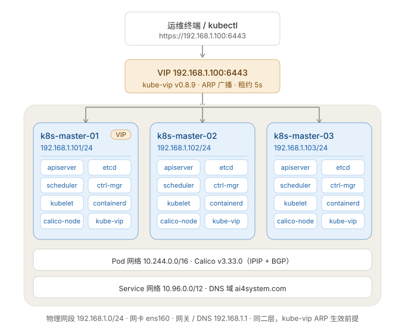

# Kubernetes v1.34 高可用控制平面安装手册（实测版）

> **文档性质**：本手册记录的是 2026-10-30 在 3 台 Ubuntu 24.04 虚拟机上**实际执行并验证通过**的完整流程，
> 所有版本号、镜像地址、命令参数均为实测值，可直接照抄复现。
>
> **与另两份文档的关系**：
> - `k8s-3node-control-plane-plan.md` → 方案论证（选型、拓扑、网段规划）
> - `k8s-control-plane-install-runbook.md` → 通用步骤清单（未含实测版本与踩坑）
> - **本手册** → 实测安装记录 + 排错手册，三者冲突时以本手册为准

| 项目 | 内容 |
|---|---|
| 部署日期 | 2026-10-30 |
| 总耗时 | 约 2.5 小时（含镜像拉取与排错） |
| 架构 | 3 × control-plane，stacked etcd，kube-vip ARP 模式提供 VIP |
| 最终状态 | 3 节点 Ready，控制面 3 副本，VIP 可漂移，etcd 3 member 健康 |
| 环境限制 | **GitHub 不可直连**，docker.io 被墙，走国内镜像加速 |

---

## 目录

- [1. 集群规划](#1-集群规划)
- [2. 部署前检查（阶段 0）](#2-部署前检查阶段-0)
- [3. 系统基线配置（阶段 1）](#3-系统基线配置阶段-1)
- [4. 关闭防火墙（阶段 2）](#4-关闭防火墙阶段-2)
- [5. 安装配置 containerd（阶段 3）](#5-安装配置-containerd阶段-3)
- [6. 安装 kubeadm 工具链（阶段 4）](#6-安装-kubeadm-工具链阶段-4)
- [7. 部署 kube-vip（阶段 5）](#7-部署-kube-vip阶段-5)
- [8. kubeadm init（阶段 6）](#8-kubeadm-init阶段-6)
- [9. 加入其余控制平面节点（阶段 7）](#9-加入其余控制平面节点阶段-7)
- [10. 安装 Calico CNI（阶段 8）](#10-安装-calico-cni阶段-8)
- [11. 集群验收（阶段 9）](#11-集群验收阶段-9)
- [12. 备份与基线固化（阶段 10）](#12-备份与基线固化阶段-10)
- [13. 踩坑清单与排错手册](#13-踩坑清单与排错手册)
- [14. 日常运维速查](#14-日常运维速查)
- [附录 A 全部脚本清单](#附录-a-全部脚本清单)
- [附录 B 销毁与重建](#附录-b-销毁与重建)
- [附录 C 镜像加速清单](#附录-c-镜像加速清单)

---

## 1. 集群规划



> 上图源文件：`k8s-topology.svg`（纯矢量，可缩放、可嵌入任何文档）

### 1.1 节点与网段（实测值）

| 主机名 | IP | 角色 | 规格 | MAC |
|---|---|---|---|---|
| k8s-master-01 | 192.168.1.101 | control-plane / init 节点 / 当前 VIP 持有者 | 4C / 15G / 57G | 00:0c:29:…:fe95 |
| k8s-master-02 | 192.168.1.102 | control-plane | 4C / 15G / 57G | 00:0c:29:…:fd:e6 |
| k8s-master-03 | 192.168.1.103 | control-plane | 4C / 15G / 57G | 00:0c:29:…:87:cd:20 |
| **API VIP** | **192.168.1.100** | kube-vip 虚拟地址 | — | 漂移 |

| 网络项 | 取值 | 说明 |
|---|---|---|
| 物理网段 | 192.168.1.0/24 | 网关/DNS = 192.168.1.1 |
| 网卡名 | **ens160** | ⚠️ VMware 克隆机，不是 eth0 |
| Pod CIDR | **10.244.0.0/16** | 不能用 192.168.0.0/16（与物理网段冲突） |
| Service CIDR | 10.96.0.0/12 | kubeadm 默认 |
| 集群 DNS 域 | **ai4system.com** | 默认 cluster.local，此处自定义 |
| 时区 | Asia/Shanghai | 原为 UTC，已改 |

### 1.2 软件版本（本次实际安装）

| 组件 | 版本 | 备注 |
|---|---|---|
| OS | Ubuntu 24.04.3 LTS | 内核 6.8.0-147-generic |
| Kubernetes | **v1.34.13** | 阿里云 apt 源 |
| containerd | **2.2.1** | 配置为 version 3 格式，与 1.7 差异大 |
| Calico | **v3.33.0** | 镜像走 quay.io |
| kube-vip | **v0.8.9** | 从 ghcr 镜像提取二进制 |
| pause 镜像 | registry.aliyuncs.com/google_containers/pause:**3.10** | |
| etcdctl | apt 的 etcd-client | 宿主机直连 127.0.0.1:2379 |

### 1.3 必需端口

| 端口 | 组件 | 范围 |
|---|---|---|
| 6443 | kube-apiserver | 全部节点 + VIP |
| 2379-2380 | etcd | 控制平面之间 |
| 10250 | kubelet | 全部节点 |
| 10257 / 10259 | controller-manager / scheduler | 本机 |
| 179 / 4 (IPIP) | Calico BGP / IPIP 封装 | 节点之间 |
| 5473 | Calico typha | 控制平面 |

> 测试环境统一 `ufw disable`，生产环境按上表放行。

### 1.4 执行顺序

```
阶段0 预检
   ↓
阶段1-4 系统基线 / 防火墙 / containerd / kubeadm   ← 三台并行
   ↓
阶段5 kube-vip  →  阶段6 kubeadm init             ← 仅 master-01，顺序执行
   ↓
阶段7 join master-02、master-03                    ← init 后 2 小时内
   ↓
阶段8 Calico  →  阶段9 验收  →  阶段10 备份固化
```

**时序硬约束**：`certificateKey` 有效期 2 小时，阶段 7 必须在阶段 6 之后 2 小时内完成，否则重新生成。

---

## 2. 部署前检查（阶段 0）

### 2.1 三台逐项确认

```bash
lsb_release -a                 # 期望 Ubuntu 24.04.x LTS
uname -r                       # 期望 6.8.x
nproc; free -h; df -h /var     # 4C / 15G / 剩余 >30G
ip -br a                       # ⚠️ 记下网卡名（本环境 = ens160）
hostnamectl                    # 期望 k8s-master-0X
```

### 2.2 连通性与 VIP 冲突检测

```bash
# 三台互 ping
ping -c2 192.168.1.101
ping -c2 192.168.1.102
ping -c2 192.168.1.103

# VIP 必须无人应答（有响应说明被占用，换地址）
ping -c2 -W1 192.168.1.100
arp -n 192.168.1.100

# 时间同步
timedatectl | grep -E "System clock|Time zone"
```

### 2.3 克隆机专项检查（本次真实踩坑）

VMware 同模板克隆机有 3 个必查项：

```bash
# ① Machine ID 必须唯一（重复会导致 K8s 节点标识混乱）
cat /etc/machine-id

# ② 主机名不能是模板默认值
hostnamectl | grep "Static hostname"

# ③ cloud-init 会覆盖网络配置，必须禁用
sudo mkdir -p /etc/cloud/cloud.cfg.d
echo 'network: {config: disabled}' | sudo tee /etc/cloud/cloud.cfg.d/99-disable-network-config.cfg
```

**修正 Machine ID**（仅对重复的机器执行）：

```bash
sudo cp /etc/machine-id /etc/machine-id.bak.$(date +%Y%m%d%H%M%S)
sudo rm -f /etc/machine-id
sudo systemd-machine-id-setup
ls -l /var/lib/dbus/machine-id      # 应是指向 /etc/machine-id 的软链
```

> 本次结果：master-01 原本唯一未动；master-02 → `d0c723ee…`；master-03 → `5d2d6b62…`，三台全部唯一。

### 2.4 检查 apt 源可用

```bash
sudo apt-get update             # 本环境用清华源，EXIT=0
```

> ⚠️ 注意：如果脚本里写成 `apt-get update | grep xxx` 并判断 `$?`，拿到的是 grep 的退出码，会误报失败。

---

## 3. 系统基线配置（阶段 1）

三台都执行：

```bash
#!/bin/bash
set -e
PW='<你的 sudo 密码>'
S() { echo "$PW" | sudo -S "$@" 2>&1 | grep -v '^\[sudo\]'; }

# ① hosts 统一
S tee /etc/hosts > /dev/null <<'EOF'
127.0.0.1       localhost
127.0.1.1       $(hostname)
192.168.1.101   k8s-master-01
192.168.1.102   k8s-master-02
192.168.1.103   k8s-master-03
192.168.1.100   k8s-api.ai4system.com k8s-api
EOF

# ② 时区
S timedatectl set-timezone Asia/Shanghai

# ③ 关闭 swap（立即 + 永久）
S swapoff -a
S sed -i '/\sswap\s/s/^/#/' /etc/fstab

# ④ 内核模块
S tee /etc/modules-load.d/k8s.conf > /dev/null <<'EOF'
overlay
br_netfilter
EOF
S modprobe overlay
S modprobe br_netfilter

# ⑤ sysctl
S tee /etc/sysctl.d/k8s.conf > /dev/null <<'EOF'
net.bridge.bridge-nf-call-iptables  = 1
net.bridge.bridge-nf-call-ip6tables = 1
net.ipv4.ip_forward                 = 1
EOF
S sysctl --system

# ⑥ 基础工具
S env DEBIAN_FRONTEND=noninteractive apt-get install -y -qq \
  curl wget vim jq net-tools openssl gnupg ca-certificates apt-transport-https
```

**验证**：

```bash
swapon --show          # 应无输出
lsmod | grep -E "overlay|br_netfilter"
sysctl net.ipv4.ip_forward      # = 1
date                            # 时区应为 CST
grep master /etc/hosts
```

---

## 4. 关闭防火墙（阶段 2）

测试环境策略：直接关闭，不做端口白名单。

```bash
sudo systemctl disable --now ufw
sudo ufw status                 # 期望 Status: inactive
sudo iptables -L -n | head      # 确认无残留 DROP 规则
```

> 生产环境改为按 [1.3 端口表](#13-必需端口) 放行，不要关闭 ufw。

---

## 5. 安装配置 containerd（阶段 3）

### 5.1 安装

```bash
sudo env DEBIAN_FRONTEND=noninteractive apt-get install -y containerd
containerd --version            # 本环境：containerd github.com/containerd/containerd/v2 2.2.1
```

### 5.2 生成并修改配置（⚠️ 2.x 与 1.7 差异大）

```bash
sudo mkdir -p /etc/containerd
sudo containerd config default | sudo tee /etc/containerd/config.toml > /dev/null
```

必须改两处：

```bash
# ① pause 镜像换成阿里云（kubeadm 默认 registry.k8s.io 不可达）
#    2.x 中的键名是 sandbox（单引号），不是 1.7 的 sandbox_image
sudo sed -i "s#^\( *\)sandbox = '.*'#\1sandbox = 'registry.aliyuncs.com/google_containers/pause:3.10'#" \
  /etc/containerd/config.toml

# ② Cgroup 驱动改 systemd
sudo sed -i 's/SystemdCgroup = false/SystemdCgroup = true/' /etc/containerd/config.toml

# ③ 关键：config_path 必须是「单个目录」，不能是冒号分隔的多目录
sudo sed -i "s#config_path = '/etc/containerd/certs.d:/etc/docker/certs.d'#config_path = '/etc/containerd/certs.d'#" \
  /etc/containerd/config.toml

grep -nE "sandbox = |SystemdCgroup|config_path" /etc/containerd/config.toml
sudo systemctl restart containerd
systemctl is-active containerd
```

> **第 ③ 条是本次最隐蔽的坑**：containerd 2.x 在 `config_path` 含多个目录时会**静默忽略整个配置**，
> 表现为 `crictl pull` 仍直连被墙的 docker.io，而 `ctr --hosts-dir` 却正常。只保留单目录后镜像加速才生效。

### 5.3 配置镜像加速

```bash
PW='<密码>'
S() { echo "$PW" | sudo -S "$@" 2>&1 | grep -v '^\[sudo\]'; }

S mkdir -p /etc/containerd/certs.d/{docker.io,ghcr.io,quay.io}

# docker.io
printf '[host."https://docker.m.daocloud.io"]\n  capabilities = ["pull", "resolve"]\n' \
  > /tmp/d.toml && S cp /tmp/d.toml /etc/containerd/certs.d/docker.io/hosts.toml

# ghcr.io（kube-vip 镜像）
printf '[host."https://ghcr.m.daocloud.io"]\n  capabilities = ["pull", "resolve"]\n' \
  > /tmp/g.toml && S cp /tmp/g.toml /etc/containerd/certs.d/ghcr.io/hosts.toml

# quay.io（Calico v3.33 镜像）
printf '[host."https://quay.m.daocloud.io"]\n  capabilities = ["pull", "resolve"]\n' \
  > /tmp/q.toml && S cp /tmp/q.toml /etc/containerd/certs.d/quay.io/hosts.toml

S systemctl restart containerd
```

> ⚠️ `hosts.toml` 里**不要写 `server = "https://docker.io"`** 这类主站行，
> 否则 containerd 仍会先尝试直连主站，超时后才回落镜像站，表现为"加速不生效"。

### 5.4 验证（必须用 CRI 路径验证，不能用 ctr）

```bash
# 这一步验证的是 kubelet 真正走的路径
sudo crictl pull docker.io/library/busybox:1.36
sudo crictl images | grep busybox     # 有输出即成功
```

同时安装 cri-tools：

```bash
sudo env DEBIAN_FRONTEND=noninteractive apt-get install -y cri-tools
crictl --version
```

> containerd 启动日志里出现 `failed to load cni config` 属正常，CNI 尚未安装。

---

## 6. 安装 kubeadm 工具链（阶段 4）

### 6.1 添加阿里云 Kubernetes 源

```bash
#!/bin/bash
PW='<密码>'
S() { echo "$PW" | sudo -S "$@" 2>&1 | grep -v '^\[sudo\]'; }

S mkdir -p /etc/apt/keyrings

# ⚠️ 必须先落盘再 dearmor：curl | sudo gpg 会因 stdin 被密码占用而得到 0 字节 key
curl -fsSL https://mirrors.aliyun.com/kubernetes-new/core/stable/v1.34/deb/Release.key \
  -o /tmp/k8s.key
ls -l /tmp/k8s.key                      # 必须 > 1KB

S gpg --dearmor -o /etc/apt/keyrings/kubernetes-apt-keyring.gpg /tmp/k8s.key
S ls -l /etc/apt/keyrings/kubernetes-apt-keyring.gpg

echo "deb [signed-by=/etc/apt/keyrings/kubernetes-apt-keyring.gpg] https://mirrors.aliyun.com/kubernetes-new/core/stable/v1.34/deb/ /" \
  | S tee /etc/apt/sources.list.d/kubernetes.list > /dev/null
```

### 6.2 安装并锁定版本

```bash
S env DEBIAN_FRONTEND=noninteractive apt-get update
S env DEBIAN_FRONTEND=noninteractive apt-get install -y kubelet kubeadm kubectl
S apt-mark hold kubelet kubeadm kubectl

kubeadm version -o short          # 期望 v1.34.13
kubectl version --client
kubelet --version
systemctl is-enabled kubelet      # enabled 但未启动，正常
```

> 三台版本必须完全一致，否则 join 会报版本偏差。

---

## 7. 部署 kube-vip（阶段 5）

### 7.1 获取二进制（本环境无 GitHub 可用）

kube-vip 从 v0.8.x 起 release 只发 SBOM、**不再附带二进制**，只能从容器镜像提取：

```bash
PW='<密码>'
S() { echo "$PW" | sudo -S "$@" 2>&1 | grep -v '^\[sudo\]'; }

# 拉镜像（走 ghcr 镜像加速）
S ctr -n k8s.io images pull --hosts-dir /etc/containerd/certs.d \
  ghcr.io/kube-vip/kube-vip:v0.8.9

# 导出 OCI 并解包
S ctr -n k8s.io images export /tmp/kv.tar ghcr.io/kube-vip/kube-vip:v0.8.9
S rm -rf /tmp/kv && S mkdir -p /tmp/kv
S tar xf /tmp/kv.tar -C /tmp/kv

# 逐层解包，找到 /kube-vip
S bash -c 'for l in /tmp/kv/blobs/sha256/*; do
  if file "$l" | grep -q "gzip compressed"; then
    tar xzf "$l" -C /tmp/kv 2>/dev/null
  fi
done'
S find /tmp/kv -name kube-vip -type f

# 安装
S install -m 0755 /tmp/kv/kube-vip /usr/local/bin/kube-vip
/usr/local/bin/kube-vip version
```

> 若本机可访问 GitHub，也可直接下载官方二进制（版本须与镜像 tag 一致）。

### 7.2 生成 static pod 清单

```bash
sudo mkdir -p /etc/kubernetes/manifests
sudo tee /etc/kubernetes/manifests/kube-vip.yaml > /dev/null <<'EOF'
apiVersion: v1
kind: Pod
metadata:
  name: kube-vip
  namespace: kube-system
spec:
  containers:
  - name: kube-vip
    image: ghcr.io/kube-vip/kube-vip:v0.8.9
    imagePullPolicy: IfNotPresent
    args: ["manager"]
    env:
    - {name: vip_arp,             value: "true"}
    - {name: port,                value: "6443"}
    - {name: vip_nodename,        valueFrom: {fieldRef: {fieldPath: spec.nodeName}}}
    - {name: vip_subnet,          value: "32"}
    - {name: vip_interface,       value: "ens160"}
    - {name: vip_address,         value: "192.168.1.100"}
    - {name: cp_enable,           value: "true"}
    - {name: cp_namespace,        value: "kube-system"}
    - {name: svc_enable,          value: "true"}
    - {name: svc_election,        value: "true"}
    - {name: vip_leaderelection,  value: "true"}
    - {name: vip_leaseduration,   value: "5"}
    - {name: vip_renewdeadline,   value: "3"}
    - {name: vip_retryperiod,     value: "1"}
    securityContext:
      capabilities:
        add: ["NET_ADMIN", "NET_RAW"]
    volumeMounts:
    - {mountPath: /etc/kubernetes/admin.conf, name: kubeconfig}
  hostNetwork: true
  volumes:
  - name: kubeconfig
    hostPath: {path: /etc/kubernetes/admin.conf, type: FileOrCreate}
EOF
```

**关键参数说明**：

| 参数 | 必须修改 | 说明 |
|---|---|---|
| `vip_interface` | ✅ 改成本机网卡 | 本环境 `ens160` |
| `vip_address` | ✅ 改成你的 VIP | 本环境 `192.168.1.100` |
| `vip_arp` | 保持 true | ARP 广播模式，要求节点同二层 |
| `cp_enable` | 保持 true | 为控制平面提供 VIP |
| `svc_enable` | 保持 true | 为 LoadBalancer 类型 Service 提供 VIP |
| `vip_leaseduration` | 可选 | 5s 租约 → VIP 漂移约 5-15 秒 |

> 此时**不要**启动 kubelet，清单等 kubeadm init 后由 kubelet 自动接管。

---

## 8. kubeadm init（阶段 6）

### 8.1 生成证书 key

```bash
kubeadm certs certificate-key          # 32 字节 hex，记录下来
```

### 8.2 配置文件

> ⚠️ **kubeadm v1.34 不允许 `--config` 与 `--certificate-key` 同时出现在命令行**，
> 证书 key 必须写进配置文件的 `certificateKey` 字段，否则直接报错退出。

```bash
sudo tee /root/kubeadm-config.yaml > /dev/null <<'EOF'
apiVersion: kubeadm.k8s.io/v1beta4
kind: InitConfiguration
localAPIEndpoint:
  advertiseAddress: 192.168.1.101
  bindPort: 6443
certificateKey: "<上一步生成的 key>"
nodeRegistration:
  criSocket: unix:///run/containerd/containerd.sock
  imagePullPolicy: IfNotPresent
  name: k8s-master-01
---
apiVersion: kubeadm.k8s.io/v1beta4
kind: ClusterConfiguration
kubernetesVersion: v1.34.13
controlPlaneEndpoint: 192.168.1.100:6443        # ← 用 VIP，不是本机 IP
imageRepository: registry.aliyuncs.com/google_containers
networking:
  podSubnet: 10.244.0.0/16
  serviceSubnet: 10.96.0.0/12
  dnsDomain: ai4system.com
apiServer:
  certSANs:
  - 192.168.1.100
  - 192.168.1.101
  - 192.168.1.102
  - 192.168.1.103
  - k8s-api.ai4system.com
  - k8s-master-01
  - 127.0.0.1
etcd:
  local:
    dataDir: /var/lib/etcd
EOF
```

### 8.3 执行初始化

```bash
# 先 dry-run 看配置是否有明显问题
sudo kubeadm init --config /root/kubeadm-config.yaml --dry-run 2>&1 | tail -20

# 正式执行（约 5-10 分钟，镜像拉取占大头）
sudo kubeadm init --config /root/kubeadm-config.yaml 2>&1 | tee /root/kubeadm-init.log
```

**成功标志**：日志末尾出现 `Your Kubernetes control-plane has initialized successfully!`，
并打印 `kubeadm join 192.168.1.100:6443 --token ... --discovery-token-ca-cert-hash ... --control-plane --certificate-key ...`。

### 8.4 配置 kubectl 并验证

```bash
mkdir -p $HOME/.kube
sudo cp /etc/kubernetes/admin.conf $HOME/.kube/config
sudo chown $(id -u):$(id -g) $HOME/.kube/config

kubectl get nodes                              # 期望 master-01 NotReady（未装 CNI）
kubectl get --raw /healthz; echo               # 期望 ok
kubectl -n kube-system get pods -o wide        # 控制面 6 个 Pod + kube-vip
ping -c2 192.168.1.100                         # VIP 应能通
ip -4 addr show ens160 | grep 192.168.1.100    # VIP 已绑到网卡
```

### 8.5 保存 join 信息

```bash
TOKEN=$(kubeadm token list | awk 'NR==2{print $1}')
CAHASH="sha256:$(openssl x509 -pubkey -in /etc/kubernetes/pki/ca.crt \
  | openssl rsa -pubin -outform der 2>/dev/null \
  | openssl dgst -sha256 -hex | sed 's/^.* //')"
CERTKEY=$(sudo cat /root/cert-key.txt)

sudo tee /root/cluster-join-info.txt > /dev/null <<EOF
TOKEN=$TOKEN
CA_HASH=$CAHASH
CERT_KEY=$CERTKEY
EOF
sudo cat /root/cluster-join-info.txt
```

> Token 默认 24 小时过期；过期后用 `kubeadm token create` 重新生成。

---

## 9. 加入其余控制平面节点（阶段 7）

### 9.1 分发 kube-vip 二进制与清单

```bash
sudo apt-get install -y sshpass

for t in 192.168.1.102 192.168.1.103; do
  sshpass -p '<密码>' scp -o StrictHostKeyChecking=no \
    /usr/local/bin/kube-vip /etc/kubernetes/manifests/kube-vip.yaml \
    lumz@$t:/tmp/
done
```

### 9.2 目标节点就位

```bash
# 在 102 / 103 上执行
sudo install -m 0755 /tmp/kube-vip /usr/local/bin/kube-vip
sudo mkdir -p /etc/kubernetes/manifests
sudo cp /tmp/kube-vip.yaml /etc/kubernetes/manifests/kube-vip.yaml
ls -l /usr/local/bin/kube-vip /etc/kubernetes/manifests/kube-vip.yaml
```

### 9.3 执行 join

```bash
sudo kubeadm join 192.168.1.100:6443 \
  --token <TOKEN> \
  --discovery-token-ca-cert-hash <CA_HASH> \
  --control-plane \
  --certificate-key <CERT_KEY> \
  --apiserver-advertise-address 192.168.1.102 \
  2>&1 | tee /root/kubeadm-join.log
```

> 102 用 `192.168.1.102`，103 用 `192.168.1.103`，其余参数相同。

### 9.4 配置各节点 kubectl 并验证

```bash
# 各自节点
mkdir -p $HOME/.kube
sudo cp /etc/kubernetes/admin.conf $HOME/.kube/config
sudo chown $(id -u):$(id -g) $HOME/.kube/config

# 在任一节点查看
kubectl get nodes -o wide
kubectl -n kube-system get pods | grep -E "apiserver|etcd|controller|scheduler|kube-vip"
```

**期望**：3 节点均 NotReady（等 CNI），控制面每类组件各 3 个副本，`kube-vip` 3/3 Running。

---

## 10. 安装 Calico CNI（阶段 8）

### 10.1 下载并打补丁

Calico v3.33 的镜像是 **quay.io**，需先配好加速（见 5.3）。

```bash
cd /tmp
curl -sL -o calico.yaml \
  "https://gh-proxy.com/https://raw.githubusercontent.com/projectcalico/calico/v3.33.0/manifests/calico.yaml"
head -3 calico.yaml
```

打两个补丁：

```bash
python3 - <<'PY'
p = 'calico.yaml'
s = open(p).read()

# ① 指定 Pod 网段（原文件里这段是注释状态）
old = '''            # - name: CALICO_IPV4POOL_CIDR
            #   value: "192.168.0.0/16"'''
new = '''            - name: CALICO_IPV4POOL_CIDR
              value: "10.244.0.0/16"
            - name: IP_AUTODETECTION_METHOD
              value: "can-reach=192.168.1.1"'''
assert old in s, "未找到 CALICO_IPV4POOL_CIDR 注释块"
open(p, 'w').write(s.replace(old, new, 1))
print("patched")
PY

grep -n -A1 -E "CALICO_IPV4POOL_CIDR|IP_AUTODETECTION_METHOD" calico.yaml
```

> **`IP_AUTODETECTION_METHOD` 不能省**：kube-vip 把 VIP 192.168.1.100 也绑在网卡上，
> Calico 默认自动探测可能选中 VIP，导致节点间路由错乱。用 `can-reach=网关` 强制选真实网卡地址。

### 10.2 应用并等待就绪

```bash
kubectl apply -f /tmp/calico.yaml

# 等待就绪（约 2-3 分钟，含镜像拉取）
kubectl -n kube-system rollout status ds/calico-node --timeout=600s
kubectl -n kube-system get pods -l k8s-app=calico-node -o wide
kubectl get nodes
kubectl get ippools.crd.projectcalico.org
```

**期望**：`calico-node` 3/3 Running，3 节点全部 Ready，生成 `default-ipv4-ippool`（10.244.0.0/16）。

> 刚启动的 30 秒内可能出现 `0/1 Running` + 就绪探针失败，属正常抖动；
> 若持续不恢复，看 `kubectl -n kube-system logs <pod> -c calico-node --tail=50`，
> 正常日志应出现 `BGP` 邻居建立与 `Calico started successfully`。

### 10.3 解除控制平面污点（3 master 集群必做）

```bash
kubectl taint nodes --all node-role.kubernetes.io/control-plane-
kubectl describe node k8s-master-01 | grep -i taint    # 期望 "无污点"/空
```

> 不做这一步，普通业务 Pod 永远 Pending。生产环境若有独立 worker，则保留污点。

---

## 11. 集群验收（阶段 9）

### 11.1 组件与节点

```bash
kubectl get nodes -o wide
kubectl -n kube-system get pods -o wide
kubectl get --raw /healthz; echo
```

| 检查项 | 期望 |
|---|---|
| 节点 | 3 台全部 `Ready` |
| apiserver / etcd / controller-manager / scheduler | 各 3 个 Running |
| coredns | 2 个 Running |
| kube-proxy / calico-node | 各 3 个 Running |
| kube-vip | 3 个 Running，仅 1 个持有 lease |
| healthz | `ok` |

### 11.2 etcd 健康

```bash
sudo apt-get install -y etcd-client

sudo ETCDCTL_API=3 etcdctl \
  --endpoints=https://127.0.0.1:2379 \
  --cacert=/etc/kubernetes/pki/etcd/ca.crt \
  --cert=/etc/kubernetes/pki/etcd/server.crt \
  --key=/etc/kubernetes/pki/etcd/server.key \
  endpoint status -w table

sudo ETCDCTL_API=3 etcdctl \
  --endpoints=https://127.0.0.1:2379 \
  --cacert=/etc/kubernetes/pki/etcd/ca.crt \
  --cert=/etc/kubernetes/pki/etcd/server.crt \
  --key=/etc/kubernetes/pki/etcd/server.key \
  endpoint health --cluster
```

> ⚠️ 不要用 `kubectl exec` 进 etcd 容器备份——快照会写进容器内路径，Pod 重建即丢。
> 一律在宿主机装 etcd-client 直连 127.0.0.1:2379。

**本次结果**：3 member 全部 started，1 个 leader（master-01），raft index 一致（9123），errors 为 0。

### 11.3 DNS 解析

```bash
kubectl run dns-test --image=docker.io/library/busybox:1.36 --restart=Never -- sleep 3600
kubectl wait --for=condition=Ready pod/dns-test --timeout=180s

kubectl exec dns-test -- nslookup kubernetes.default.svc.ai4system.com
kubectl exec dns-test -- cat /etc/resolv.conf
```

**期望**：解析到 `10.96.0.1`，`search` 域为 `default.svc.ai4system.com svc.ai4system.com ai4system.com`。

### 11.4 跨节点 Pod 网络

```bash
kubectl create deploy web --image=docker.io/library/nginx:alpine --replicas=3
kubectl expose deploy web --port=80
kubectl rollout status deploy/web --timeout=300s
kubectl get pods -o wide            # 三个 Pod 应分散在不同节点

kubectl run curl-test --image=docker.io/library/busybox:1.36 --restart=Never \
  -- sh -c 'wget -qO- --timeout=5 http://web; echo EXIT=$?'
sleep 15
kubectl logs curl-test | tail -3    # 期望返回 nginx 欢迎页 HTML
```

### 11.5 VIP 与 API 连续性

```bash
ping -c3 192.168.1.100
curl -sk https://192.168.1.100:6443/healthz; echo
kubectl -n kube-system get lease plndr-cp-lock -o yaml | grep holderIdentity
```

### 11.6 VIP 漂移演练（可选，需控制台权限）

```bash
# 1. 记录当前持有者
kubectl -n kube-system get lease plndr-cp-lock -o jsonpath='{.spec.holderIdentity}{"\n"}'

# 2. 在 VMware 关机当前持有者（如 master-01），然后外部持续 ping VIP
ping -i 0.5 192.168.1.100

# 3. 期望 5-15 秒内 VIP 切换到另一节点，ping 恢复
# 4. 开机后确认 master-01 自动回群
kubectl get nodes
```

### 11.7 清理测试资源

```bash
kubectl delete pod dns-test curl-test --ignore-not-found
kubectl delete deploy web --ignore-not-found
kubectl delete svc web --ignore-not-found
```

---

## 12. 备份与基线固化（阶段 10）

### 12.1 etcd 快照脚本

```bash
sudo tee /usr/local/bin/etcd-backup.sh > /dev/null <<'EOF'
#!/bin/bash
set -euo pipefail
BACKUP_DIR=/var/backups/etcd
mkdir -p "$BACKUP_DIR"
ETCDCTL_API=3 etcdctl \
  --endpoints=https://127.0.0.1:2379 \
  --cacert=/etc/kubernetes/pki/etcd/ca.crt \
  --cert=/etc/kubernetes/pki/etcd/server.crt \
  --key=/etc/kubernetes/pki/etcd/server.key \
  snapshot save "$BACKUP_DIR/snapshot-$(date +%F-%H%M).db"
# 保留 7 天
find "$BACKUP_DIR" -name 'snapshot-*.db' -mtime +7 -delete
EOF

sudo chmod +x /usr/local/bin/etcd-backup.sh
sudo /usr/local/bin/etcd-backup.sh
sudo ls -lh /var/backups/etcd/

# 校验快照完整性
sudo ETCDCTL_API=3 etcdctl snapshot status /var/backups/etcd/snapshot-*.db -w table

# 每日 2:00 定时
( sudo crontab -l 2>/dev/null; echo '0 2 * * * /usr/local/bin/etcd-backup.sh >> /var/log/etcd-backup.log 2>&1' ) | sudo crontab -
sudo crontab -l
```

> 三台都要配（各自备份本地 etcd，避免单点）。

### 12.2 PKI 与 join 信息打包

```bash
sudo tar czf /root/k8s-pki-$(date +%Y%m%d).tar.gz \
  -C /etc/kubernetes pki admin.conf controller-manager.conf scheduler.conf
sudo tar tzf /root/k8s-pki-*.tar.gz | wc -l        # 本次 27 项
sudo ls -lh /root/k8s-pki-*.tar.gz

# join 信息
sudo cat /root/cluster-join-info.txt
```

> **把 PKI 包离线保存到安全位置**（U 盘/密码库）。丢了 CA 就无法新增节点或恢复集群。

### 12.3 配置快照

```bash
mkdir -p ~/k8s-backup && cd ~/k8s-backup
kubectl get nodes,all -A -o wide > cluster-state-$(date +%F).txt
kubectl -n kube-system get cm kubeadm-config -o yaml > kubeadm-config-cm.yaml
kubectl -n kube-system get cm kube-proxy -o yaml > kube-proxy-cm.yaml
```

### 12.4 版本锁定确认

```bash
apt-mark showhold        # 期望列出 kubelet kubeadm kubectl
```

---

## 13. 踩坑清单与排错手册

| # | 现象 | 根因 | 解法 |
|---|---|---|---|
| 1 | GPG key 文件 0 字节，apt 报 `NO_PUBKEY` | `curl \| sudo gpg --dearmor` 时 sudo 密码占用 stdin | 先 `curl -o` 落盘，再 `gpg --dearmor -o` |
| 2 | `kubeadm init` 报 `--config and --certificate-key cannot be used together` | v1.34 参数校验变严 | `certificateKey` 写进 `InitConfiguration` |
| 3 | pause 镜像 sed 不生效 | containerd 2.x 是 version 3 配置，键名为 `sandbox` | 用 `sandbox = '...'` 单引号匹配 |
| 4 | **镜像加速"配置了但不生效"** | `config_path` 含多个冒号分隔目录时被**静默忽略** | 改为单目录 `/etc/containerd/certs.d` |
| 5 | `crictl pull` 仍直连被墙源 | `hosts.toml` 里写了 `server = 主站` | 只保留 `[host."镜像站"]` 段 |
| 6 | GitHub 全不可达，release 无二进制 | 网络封锁 + kube-vip 新版只发 SBOM | 从 ghcr 镜像导出 OCI 提取 `/kube-vip` |
| 7 | Calico 节点间不通 / 误绑 VIP | `IP_AUTODETECTION_METHOD` 未设 | 设 `can-reach=192.168.1.1` |
| 8 | 业务 Pod 永远 Pending | 3 master 全带 `NoSchedule` 污点 | `kubectl taint nodes --all node-role.kubernetes.io/control-plane-` |
| 9 | etcd 快照"生成了但找不到" | `kubectl exec` 备份写进容器内路径 | 宿主机装 etcd-client 直连 2379 |
| 10 | 克隆机重启后 IP 变回模板值 | cloud-init 重新生成 netplan | 写入 `99-disable-network-config.cfg` |
| 11 | 节点注册异常 / 证书混乱 | 克隆机 Machine ID 重复 | `rm /etc/machine-id` + `systemd-machine-id-setup` |

### 常用排错命令

```bash
# kubelet 起不来
sudo journalctl -u kubelet -n 100 --no-pager
sudo systemctl status kubelet

# 容器运行时
sudo systemctl status containerd
sudo journalctl -u containerd --since "5 min ago" | grep -iE "error|fail"
sudo crictl ps -a; sudo crictl images

# Pod 卡住
kubectl describe pod <pod> -n <ns>          # 看 Events 段
kubectl -n kube-system logs <pod> --previous

# 节点 NotReady
kubectl describe node <node> | grep -A10 Conditions

# 镜像拉不动：开 containerd debug 日志
sudo sed -i "/^\[debug\]/,/^\[/ s/level = .*/level = 'debug'/" /etc/containerd/config.toml
sudo systemctl restart containerd
sudo journalctl -u containerd --since "1 min ago" | grep -iE "hosts.toml|trying|mirror"
# 排查完记得改回 info

# 重置单节点（慎用，会清空该节点 K8s 状态）
sudo kubeadm reset -f
sudo rm -rf /etc/cni/net.d /var/lib/cni /var/lib/etcd
sudo systemctl restart containerd kubelet
```

---

## 14. 日常运维速查

```bash
# 集群状态总览
kubectl get nodes -o wide
kubectl -n kube-system get pods -o wide
kubectl get --raw /healthz; echo

# VIP 当前持有者
kubectl -n kube-system get lease plndr-cp-lock -o jsonpath='{.spec.holderIdentity}{"\n"}'

# 新增 join token（默认 24h 过期）
kubeadm token create --print-join-command
# 控制平面节点需要额外 --control-plane --certificate-key
kubeadm init phase upload-certs --upload-certs      # 重新上传证书

# 查看证书有效期
sudo kubeadm certs check-expiration

# 证书续期（到期前执行，逐台）
sudo kubeadm certs renew all && sudo systemctl restart kubelet

# etcd 手动快照
sudo /usr/local/bin/etcd-backup.sh

# 节点维护（优雅驱逐）
kubectl drain <node> --ignore-daemonsets --delete-emptydir-data
kubectl uncordon <node>

# 版本升级（先升控制面再升 kubelet；本环境已 hold，需先 unhold）
sudo apt-mark unhold kubeadm && sudo apt-get install -y kubeadm=1.35.x-1.1 \
  && sudo kubeadm upgrade plan && sudo kubeadm upgrade apply v1.35.x
```

> 本章只保留最高频的十几条。完整运维命令（按场景组织的 13 章 + 排错五步法 + Pod 状态字典 + 高危命令红黑榜）见 **`k8s-ops-commands.md`**。

---

## 附录 A 全部脚本清单

本次部署脚本保存在 `.workbuddy/tmp/`：

| 脚本 | 作用 |
|---|---|
| `rssh.sh` | 远程执行脚本（expect 封装，`rssh.sh <IP> <本地脚本> <超时>`） |
| `scp_to.sh` | 上传文件到节点 |
| `p0_check.sh` | 阶段 0 预检 |
| `p1_baseline.sh` | 阶段 1 系统基线 |
| `p2p3.sh` | 阶段 2-3 防火墙 + containerd |
| `p4_tools.sh` / `p4_fix.sh` | 阶段 4 工具链（含 GPG 修复） |
| `p5_prep.sh` / `p5_extract2.sh` / `p5_manifest.sh` | 阶段 5 kube-vip |
| `p6_init2.sh` / `p6_verify.sh` | 阶段 6 init 与验证 |
| `p7_prep.sh` / `p7_join.sh` | 阶段 7 join |
| `p8_prep.sh` / `p8_apply.sh` | 阶段 8 Calico |
| `p9_verify1.sh` / `p9_verify2.sh` / `p9_dbg.sh` | 阶段 9 验收 |
| `p10_fix.sh` | 阶段 10 etcd 备份与 PKI 打包 |
| `health_check.sh` | 通用主机健康巡检（可复用于任意节点） |

**远程执行封装 `rssh.sh` 核心逻辑**（无 sshpass 环境可用）：

```bash
#!/bin/bash
# 用法: ./rssh.sh <IP> <本地脚本> [超时秒]
HOST=$1; SCRIPT=$2; TMO=${3:-120}
export HOST SCRIPT TMO
export PW='<密码>'
export B64=$(base64 -i "$SCRIPT" | tr -d '\n')
expect -c '
set timeout $env(TMO)
log_user 0
spawn ssh -o StrictHostKeyChecking=no -o UserKnownHostsFile=/dev/null \
  -o PreferredAuthentications=password -o PubkeyAuthentication=no \
  lumz@$env(HOST) "echo $env(B64) | base64 -d > /tmp/_run.sh && bash /tmp/_run.sh"
expect {
  -re "(?i)password:" { send "$env(PW)\r"; exp_continue }
  eof
}'
```

> ⚠️ 封装 sudo 时**不要**用 `echo $PW | sudo -S "$@"` 同时又让命令读 stdin（如 `curl |`），会互相抢占。

---

## 附录 B 销毁与重建

**单节点退出集群**：

```bash
kubectl drain <node> --ignore-daemonsets --delete-emptydir-data
kubectl delete node <node>

# 在该节点执行
sudo kubeadm reset -f
sudo rm -rf /etc/cni/net.d /var/lib/cni /var/lib/etcd $HOME/.kube
sudo systemctl restart containerd kubelet
```

**整个集群重建**（三台都执行 reset 后从阶段 1 重来）：

```bash
# 全局删除残留 iptables / 网卡
sudo iptables -F && sudo iptables -t nat -F && sudo iptables -t mangle -F
sudo ip link delete cni0 2>/dev/null
sudo ip link delete tunl0 2>/dev/null
sudo ip link delete vxlan.calico 2>/dev/null
```

> 重建时注意：`certificateKey` 需重新生成，`kube-vip.yaml` 可复用。

---

## 附录 C 镜像加速清单

`hosts.toml` 统一格式（放在 `/etc/containerd/certs.d/<registry>/hosts.toml`）：

```toml
[host."https://<镜像站>"]
  capabilities = ["pull", "resolve"]
```

| 上游 Registry | 镜像站 | 用途 |
|---|---|---|
| docker.io | `docker.m.daocloud.io` | 业务镜像、busybox、nginx |
| ghcr.io | `ghcr.m.daocloud.io` | kube-vip |
| quay.io | `quay.m.daocloud.io` | Calico v3.33 |
| registry.k8s.io | 用阿里云替代：`imageRepository: registry.aliyuncs.com/google_containers` | 控制面组件 |

**生效前提（三条都要满足，缺一不可）**：

1. `/etc/containerd/config.toml` 中 `config_path = '/etc/containerd/certs.d'`（**单目录**，不能有冒号）
2. `hosts.toml` 中**不写** `server = "https://原站"`
3. 改完 `systemctl restart containerd`，并用 **`crictl pull`** 验证（`ctr --hosts-dir` 的验证结果不代表 kubelet 路径）

---

## 变更记录

| 日期 | 内容 |
|---|---|
| 2026-10-30 | 首版。基于实际部署过程整理：K8s v1.34.13 + containerd 2.2.1 + Calico v3.33.0 + kube-vip v0.8.9，3 节点 HA 控制平面，全部验收通过 |
